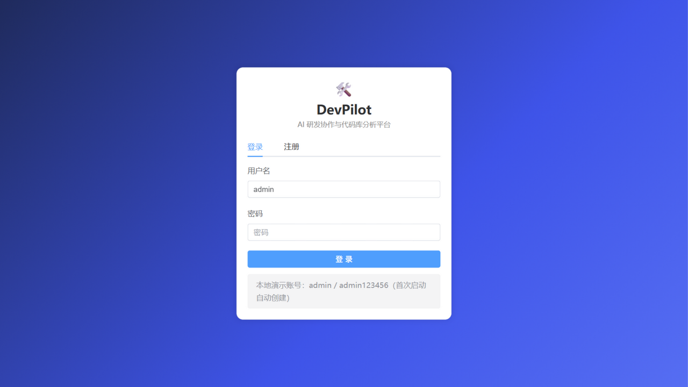
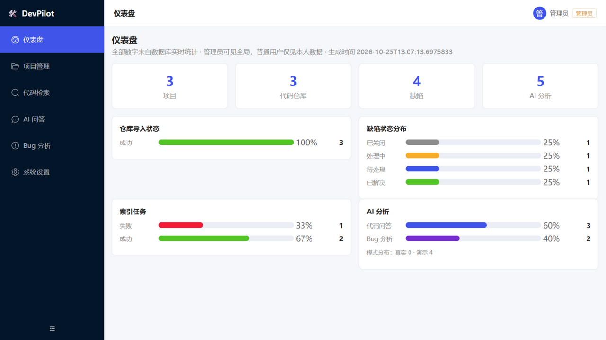
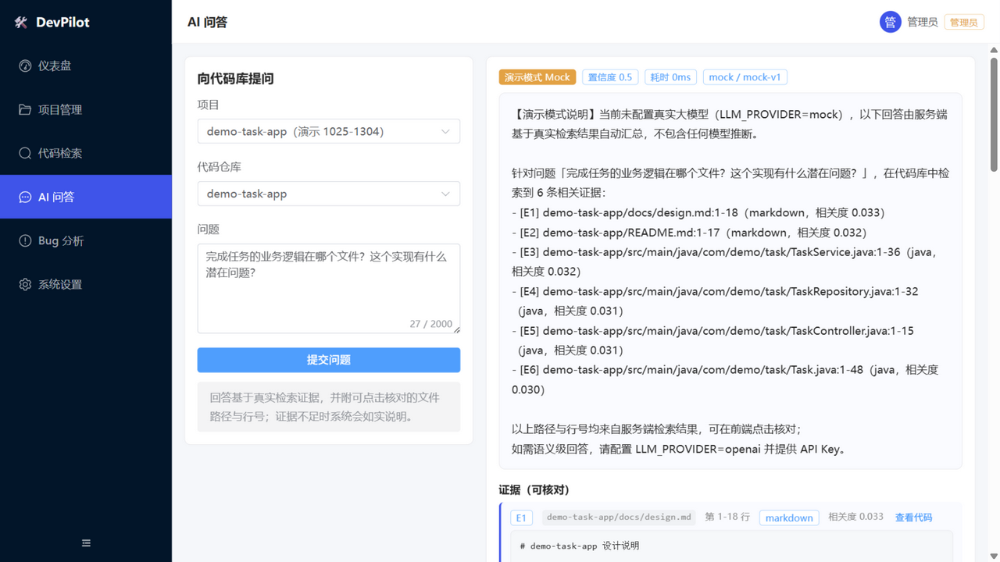
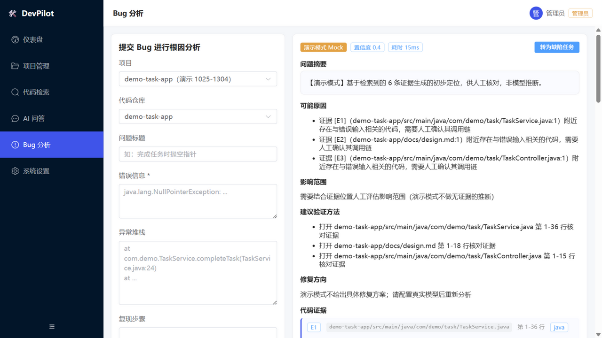
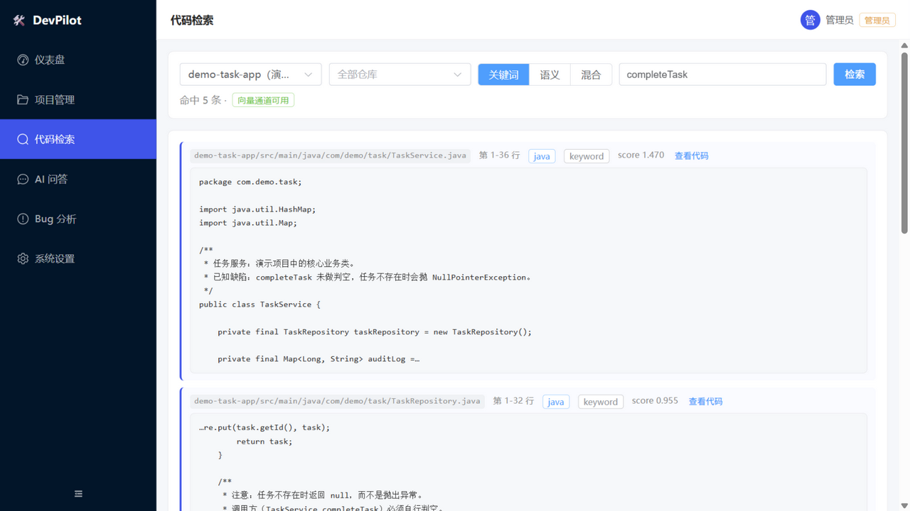
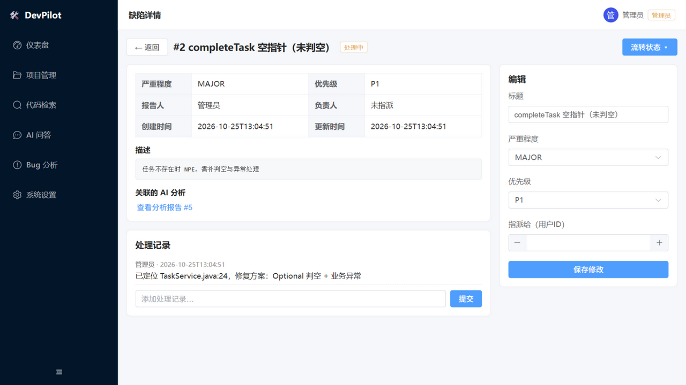
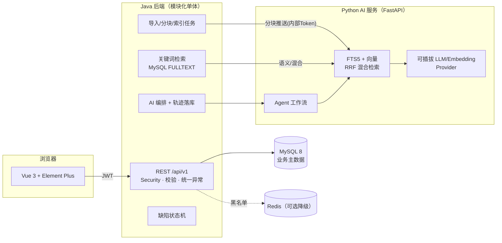

# DevPilot · AI 研发协作与代码库分析平台

> 面向中小研发团队的自托管平台：**代码库导入与索引 → 关键词/语义混合检索 → 带证据引用的 AI 问答与 Bug 根因分析 → 缺陷任务闭环**，多用户权限与项目数据隔离。
>
> 本项目由仓库所有者在 **AI 辅助下完成**，是一份真实、可运行、可测试的学习型工程作品。完成情况与未验证事项全部如实披露（见 [docs/learning/12-项目真实完成情况与个人贡献记录.md](docs/learning/12-项目真实完成情况与个人贡献记录.md)）。

     

---

## 核心特性

| 能力 | 说明 |
|---|---|
| 🔐 认证与权限 | JWT（登出黑名单）、ADMIN/USER 双角色、路由级 + 数据级双层鉴权、登录失败限流，**越权访问有自动化测试证明** |
| 📦 代码库导入 | zip 上传 / 公开 Git URL（https，防 SSRF）；依赖目录、二进制、敏感文件自动过滤并**记录原因**；绝不执行用户导入的代码 |
| 🔎 检索 | MySQL FULLTEXT(ngram) 关键词通道 + Python 侧 FTS5/向量双通道 RRF 混合检索；结果带文件路径、行号、相关度与通道标注 |
| 🤖 AI 问答与 Bug 分析 | 8 步 Agent 工作流（校验→多路检索→证据装配→生成→结构化校验→**引用合法性核查**）；每条结论附可点击核对的代码证据；可插拔 Provider（OpenAI 兼容 / 显式标注的 Mock） |
| 🐞 缺陷闭环 | 状态机服务端校验（非法流转 409）、AI 分析一键转缺陷、处理记录、与检索/分析同项目隔离 |
| 📊 仪表盘 | 全部数字来自数据库实时统计，空数据有空状态提示 |
| 🧪 工程质量 | 后端 20 个 JUnit（真实 MySQL）、AI 服务 31 个 pytest、前端 vitest + 构建门禁、**18 步 E2E 全链路脚本**、GitHub Actions CI |
| 🧯 诚实降级 | Embedding/LLM/Redis/Python 任一不可用都有明确降级与标识，不伪装成功 |

## 界面预览（真实运行截图）

| 登录 | 仪表盘（真实统计） |
|---|---|
|  |  |

| AI 问答（Mock 模式 + 证据引用 + Agent 轨迹） | Bug 根因分析报告 |
|---|---|
|  |  |

| 代码检索 | 缺陷详情 |
|---|---|
|  |  |

> 截图来自本机实际运行的系统（Windows 11 + JDK 21 + MySQL 8.0.34），未做任何修饰。

## 架构



详细设计：[docs/ARCHITECTURE.md](docs/ARCHITECTURE.md) · [docs/AI_WORKFLOW.md](docs/AI_WORKFLOW.md) · [docs/DATABASE.md](docs/DATABASE.md) · [docs/API_CONTRACT.md](docs/API_CONTRACT.md)

## 快速开始（Docker Compose）

> ⚠️ 诚实声明：本仓库作者的开发机没有 Docker，**compose 路径未在本机实际运行过**，以下步骤按标准 compose 流程编写，欢迎 issue 反馈问题。

```bash
cp .env.example .env        # 修改 JWT_SECRET / INTERNAL_TOKEN / ADMIN_PASSWORD
docker compose up -d --build
# 前端:      http://localhost:8090
# 后端 API:  http://localhost:8080  Swagger: http://localhost:8080/swagger-ui.html
# AI 服务:   http://localhost:8200/health
# 演示账号:  admin / admin123456（生产务必修改 ADMIN_PASSWORD）
```

## 快速开始（本地开发，作者实际验证的路径）

环境要求：JDK 21、Maven 3.9+、Python 3.11+、Node 22+、MySQL 8、Git。

```bash
# 0) 准备数据库（也可用本机已有的 MySQL 实例）
mysql -h127.0.0.1 -P3307 -uroot -e "CREATE DATABASE devpilot DEFAULT CHARACTER SET utf8mb4;"

# 1) 启动 Python AI 服务（默认 mock 模式，无需任何 Key）
cd ai-service
pip install -r requirements.txt
python -m uvicorn app.main:app --host 127.0.0.1 --port 8200

# 2) 启动 Java 后端（默认连接 127.0.0.1:3307，可用环境变量覆盖）
cd backend
mvn spring-boot:run
# Windows 若默认 JDK 非 21：JAVA_HOME=<jdk21路径> mvn spring-boot:run

# 3) 启动前端
cd frontend
npm install
npm run dev      # http://localhost:5173

# 4) 一键演示数据（可选）
python scripts/demo_seed.py
```

默认配置连接 `127.0.0.1:3307/devpilot`（无密码 root，作者本机专用实例）；使用你自己的 MySQL 时：

```bash
DB_URL="jdbc:mysql://127.0.0.1:3306/devpilot?useUnicode=true&characterEncoding=utf8&serverTimezone=Asia/Shanghai&useSSL=false&allowPublicKeyRetrieval=true" \
DB_USERNAME=root DB_PASSWORD=你的密码 \
JWT_SECRET="至少32字节的随机串" \
mvn spring-boot:run
```

全部配置项见 [.env.example](.env.example) 与 [docs/learning/01-开发环境搭建.md](docs/learning/01-开发环境搭建.md)。

## 验证

```bash
# 后端测试（需 MySQL devpilot_test@3307，或用 TEST_DB_* 环境变量指向你的库）
cd backend && mvn test                  # ✅ 20/20（本机 Windows 11 + MySQL 8.0.34 实测）

# AI 服务测试（无需任何外部依赖）
cd ai-service && python -m pytest tests/ -q   # ✅ 31/31

# 前端
cd frontend && npm run build && npm test      # ✅ 构建 + 3/3

# 端到端业务流程（需三端已启动）
python scripts/e2e_flow.py               # ✅ 18/18：注册→登录→建项目→上传→索引→
                                         #    中英文检索→AI问答→Bug分析→缺陷流转→越权→仪表盘
```

各环境实测结果与未覆盖项见 [docs/TEST_REPORT.md](docs/TEST_REPORT.md)。

## 使用真实大模型

默认 `LLM_PROVIDER=mock`：回答基于真实检索证据做模板化汇总，界面上有醒目的「演示模式 Mock」徽标——**绝不伪装成真实模型输出**。配置 OpenAI 兼容 API 后切换为真实模型（注意：真实 Provider 的调用效果未在仓库作者处验证，属已知限制）：

```env
LLM_PROVIDER=openai
LLM_BASE_URL=https://api.openai.com/v1   # 或任何 OpenAI 兼容网关
LLM_API_KEY=sk-xxx
LLM_MODEL=gpt-4o-mini
```

## 项目结构

```
devpilot/
├── backend/          # Java 21 · Spring Boot 3.5 · MyBatis-Plus · Flyway
│   └── src/main/java/com/devpilot/
│       ├── common/   # 统一响应/异常/配置
│       ├── security/ # JWT 过滤器、黑名单（Redis/内存双实现）
│       └── module/   # auth · user · project · indexing · search · ai · defect · stats
├── ai-service/       # FastAPI · 8步Agent工作流 · FTS5+向量混合检索
├── frontend/         # Vue 3 · Vite · Element Plus · Pinia
├── docker/           # 三个 Dockerfile + nginx.conf
├── docker-compose.yml
├── docs/             # 设计文档 + 测试报告 + docs/learning/ 13篇学习材料
├── fixtures/         # 演示代码库（含被过滤文件演示与埋设的空指针缺陷）
└── scripts/          # e2e_flow.py · demo_seed.py
```

## 已知限制与后续计划（P1 Roadmap）

如实披露，不吹牛：

- **同步 AI 调用**：问答/分析为同步请求（最长 90s），异步任务队列在 P1；
- **Git 导入仅支持公开 https 仓库**，不托管私有凭据；不支持 Git 提交历史分析（P1）；
- **SQLite 向量检索为单机实现**（纯 Python 余弦 + 特征哈希降级），规模上限约 5 万分块，更大规模应迁移专用向量库（接口已预留）；
- **Redis 为可选组件**：不可用时黑名单降级为进程内实现，仅适合单实例部署；
- 无操作审计日志、无导出、无测试建议生成（P1，见 [docs/PRD.md](docs/PRD.md)）；
- Docker Compose 路径与真实 LLM Provider 未在作者环境验证（见测试报告）。

## 给初学者：从这里读懂它

[docs/learning/](docs/learning/) 提供了 13 篇面向初学者的材料（00 项目总览 → 06 RAG 检索 → 07 Agent 工作流 → 10 面试问答 → 11 六周重学路线 → 12 真实完成情况记录），每篇都基于仓库真实代码路径，先讲为什么、再讲原理、最后落到代码。

## 许可证与贡献

[MIT License](LICENSE) · 欢迎按 [CONTRIBUTING.md](CONTRIBUTING.md) 参与贡献 · 行为准则见 [CODE_OF_CONDUCT.md](CODE_OF_CONDUCT.md)
