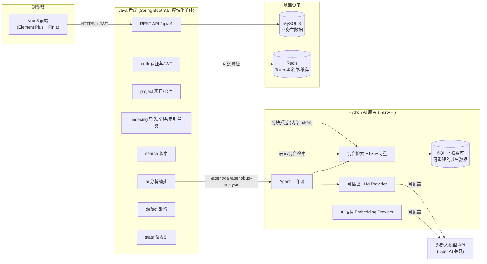

# DevPilot 架构设计

> 本文回答三个问题：系统怎么组成、为什么这样选、失败时如何表现。

## 1. 总体架构



**设计原则**：两个服务各司其职——Java 是业务与数据的唯一权威（MySQL 是 source of truth），Python 是无状态的检索与推理引擎（SQLite 索引库是可随时重建的派生数据）。Java 与 Python 之间用内部 Token 鉴权的 REST 契约连接（见 `docs/API_CONTRACT.md`）。

## 2. 模块划分（后端）

模块化单体，按业务垂直切分，控制器不写业务逻辑：

```
com.devpilot
├── common/            统一响应 ApiResponse、错误码、全局异常、通用配置
│   ├── config/        Security / OpenAPI / MyBatis-Plus / Async / Redis降级 / CORS
│   └── api|exception/ R<T>、ErrorCode、BizException、GlobalExceptionHandler
├── security/          JwtService、JwtAuthFilter、UserPrincipal、SecurityUtils
└── module/
    ├── auth/          注册/登录/登出（登录失败限流）
    ├── user/          用户管理（仅管理员）、个人信息
    ├── project/       项目 CRUD + 代码仓库（zip 上传 / Git URL 导入）
    ├── indexing/      导入安全检查 → 解析过滤 → 分块 → 索引任务状态机 → 推送 Python
    ├── search/        关键词(MySQL FULLTEXT) / 语义 / 混合检索
    ├── ai/            AI 客户端 + 分析记录/步骤持久化（QA 与 Bug 分析）
    ├── defect/        缺陷任务状态机 + 处理记录 + 关联分析
    └── stats/         仪表盘聚合查询
```

**边界规则**：Controller 只做参数校验与组装；业务与权限校验在 Service；跨模块只允许调用对方 Service；数据归属检查（防越权）统一在各 Service 入口执行。

## 3. 技术选型与理由

| 选型 | 理由 | 被否决的替代方案 |
|---|---|---|
| 模块化单体 | 团队规模与流量不需要微服务；单体内模块边界清晰即可演进 | 微服务（运维成本与业务规模不匹配） |
| Spring Boot 3.5 + Java 21 | 主流企业栈、长期支持、虚拟线程可用 | Spring Boot 2（EOL）、Quarkus（生态学习成本） |
| MyBatis-Plus 3.5 | SQL 可控 + 基础 CRUD 免写；国内企业主流，面试加分 | JPA（复杂 SQL 表达成本高）、裸 MyBatis（样板代码多） |
| MySQL 8 FULLTEXT(ngram) | 关键词检索够用且零额外运维 | Elasticsearch（MVP 规模下是过度设计，运维成本高）；LIKE 全表（无索引，规模上限低） |
| SQLite(FTS5)+向量文件 作为 AI 侧检索库 | 零部署成本、随仓库一键重建；架构上保留升级 Milvus/pgvector 的接口 | 独立向量数据库（增加一个有状态组件，MVP 收益为负） |
| Redis（可选降级） | 登出黑名单与热点缓存的标准做法；不可用时自动降级为进程内实现，开发环境零依赖 | 强依赖 Redis（提高本地体验门槛） |
| Flyway | 迁移脚本进 Git，任何环境可重建库 | 手工 SQL（不可追溯） |
| JWT (jjwt 0.13) | 无状态、前后端分离标准做法；配合登出黑名单弥补无法吊销的短板 | Session（多端体验与水平扩展稍逊） |
| FastAPI + Pydantic | AI 生态最顺手；Pydantic 做结构化输出校验 | Flask（无原生异步与校验） |
| Vue 3 + Element Plus | 企业中后台成熟度最高 | Ant Design Vue（同样可行，团队熟悉度取舍） |

## 4. 关键设计决策

### 4.1 检索双通道
- **关键词**：MySQL `code_chunk` 表建 FULLTEXT(ngram) 索引，Java 直接查询——不依赖 Python 可用。
- **语义/混合**：Java 把分块推送给 Python，Python 用 SQLite FTS5 + 向量余弦 + RRF 融合。Embedding Provider 不可用时自动只开关键词通道，并在响应中返回 `vectorEnabled=false` 明确告知（不伪装向量检索成功）。

### 4.2 AI 调用为什么是同步的
MVP 的问答/分析单次 < 90s，同步请求 + 前端加载态 + 90s 总超时即可；引入消息队列属于 P1（异步任务化已列入路线图）。避免 MVP 阶段为了架构表演引入 MQ。

### 4.3 并发与幂等
- **索引任务防重复**：`index_task.active` 列由应用维护——PENDING/RUNNING 时为 1、终态置 NULL，配合 `UNIQUE(repository_id, active)` 让数据库拒绝同一仓库的并发重复任务（NULL 不参与唯一约束，历史任务可共存）。
- **导入安全**：zip 条目数/总大小/单文件大小三重上限、Zip-Slip 规范路径校验、扩展名白名单、目录黑名单（node_modules/target/…）、二进制探测，全部拒绝时记录原因不中断导入。
- **用户导入的代码永远不执行**：解析是纯文本 IO；Git 导入仅 `git clone --depth 1` 公开 HTTPS 仓库，URL 协议白名单校验。

### 4.4 降级矩阵（用户可见的诚实降级）

| 故障 | 系统表现 |
|---|---|
| 外部 LLM 不可用 | 问答/分析返回明确错误；管理员可切 `LLM_PROVIDER=mock`，前端显示"演示模式"徽标 |
| Embedding 不可用 | 语义检索自动关闭，仅关键词可用；响应带 `vectorEnabled=false` |
| Redis 不可用 | 启动时自动切换进程内黑名单实现，日志 WARN（文档说明集群限制） |
| Python 服务不可用 | 语义检索与 AI 功能返回 503 级错误提示；关键词搜索、缺陷管理不受影响 |
| 重复触发索引 | 幂等拒绝并提示已有进行中任务 |

## 5. 安全模型

1. **认证**：JWT HS256（密钥≥32字符，环境变量注入），有效期 2h；登出后 Token 进黑名单（Redis TTL=剩余有效期）。
2. **授权**：接口级（SecurityConfig 路由规则 + `@PreAuthorize`）+ 数据级双层校验；所有项目域数据按 owner 隔离，ADMIN 可跨域；越权统一返回 403。
3. **导入安全**：见 4.3；上传文件名服务端重命名，存储路径不落用户输入。
4. **AI 安全**：检索内容一律视为不可信数据（见 `docs/AI_WORKFLOW.md` 的注入防护）；Agent 无任何 Shell/SQL/网络执行能力，MVP 只读。
5. **密钥管理**：全部环境变量，`.env` 进 `.gitignore`，提供 `.env.example`；启动时校验生产必需配置并在缺失时 fail-fast。
