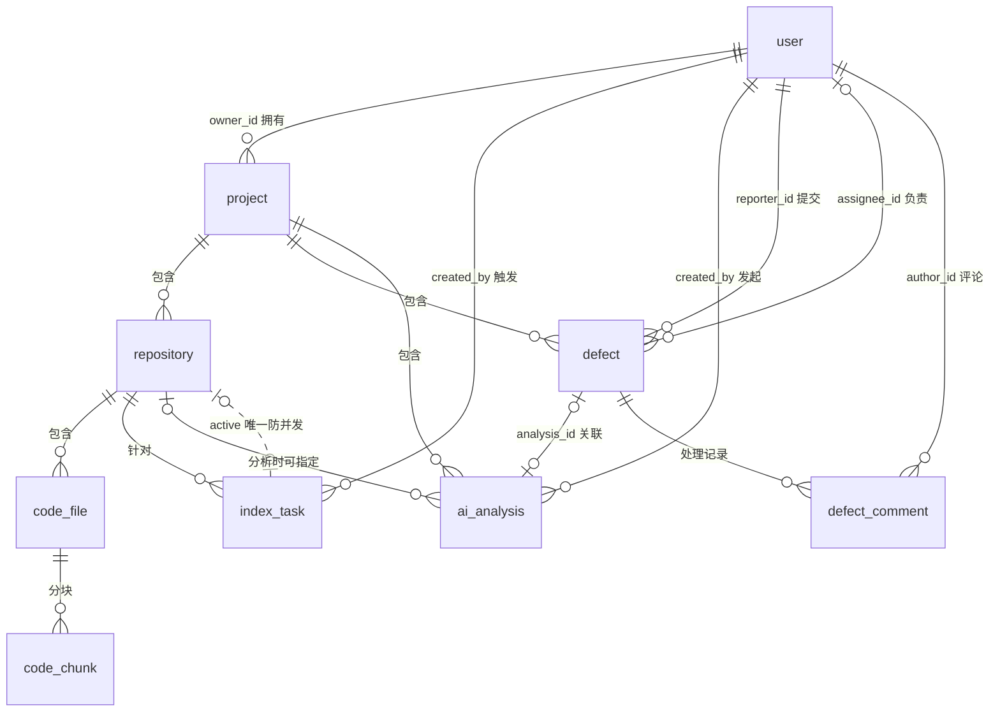

# DevPilot 数据库设计

> 数据库：MySQL 8.0，库名 `devpilot`（字符集 utf8mb4 / utf8mb4_unicode_ci）。
> 迁移脚本：`backend/src/main/resources/db/migration/`，由 Flyway 在应用启动时自动执行，禁止手工改表。

## 1. ER 图

## 2. 表清单与设计要点

| 表 | 职责 | 关键约束与索引 |
|---|---|---|
| `user` | 账号与角色 | `uk_username` 唯一；`role` 仅 ADMIN/USER；逻辑删除 `deleted` |
| `project` | 项目 | `uk_owner_name(owner_id,name)` 同一用户项目不重名；FK→user |
| `repository` | 导入的代码仓库（zip 或 Git URL） | FK→project；`import_status` 状态机；失败原因落 `error_message` |
| `code_file` | 文件清单与内容 | FK→repository；`idx_repo_path(repository_id,path前缀)`；被过滤文件记录 `skip_reason`（binary/too_large/unsupported/dependency_dir…） |
| `code_chunk` | 代码分块（检索单元） | FK→code_file(级联删除)；`FULLTEXT ngram(content)` 支撑关键词检索；`idx_repo` |
| `index_task` | 索引任务（状态机） | `uk_task_no` 幂等号；**`active` 生成列技巧**：PENDING/RUNNING 时=1、终态=NULL，`UNIQUE(repository_id, active)` 在数据库层面杜绝同仓库并发重复索引 |
| `ai_analysis` | AI 问答/Bug 分析记录 | FK→project；`mode` 区分 real/mock；`structured_result` JSON；`confidence` 0~1 |
| `analysis_step` | Agent 执行轨迹 | FK→ai_analysis(级联)；`step_order` 有序；明细截断+脱敏后落库 |
| `defect` | 缺陷任务 | FK→project/reporter/assignee；状态机 OPEN→IN_PROGRESS→RESOLVED→CLOSED（RESOLVED 可退回 OPEN），非法流转服务端拒绝 |
| `defect_comment` | 处理记录 | FK→defect(级联)/author |

完整 DDL 见 `backend/src/main/resources/db/migration/V1__init.sql`（带注释）。

## 3. 关键设计决策

- **主键**：全部 `BIGINT AUTO_INCREMENT`；对外暴露不依赖 ID 连续性。
- **外键**：MVP 明确使用物理外键（数据规模小、优先正确性），删除策略：子数据随主数据级联（chunk/file/comment/step）或由服务层显式清理（repository/project 软删除保留历史）。
- **软删除**：`user/project/repository/defect` 带 `deleted` 标志（MyBatis-Plus `@TableLogic`）——项目删除后分析记录仍可审计；`code_file/code_chunk` 硬删除（可随时由重新索引重建，属于派生数据）。
- **并发控制**：索引任务用 `active` 唯一索引（NULL 不参与唯一约束），插入冲突时返回 409"已有进行中的索引任务"；AI 分析为一次性记录，天然幂等。
- **事务边界**：导入落库（删旧文件/分块+写新文件/分块+更新任务状态）在 Service 层单事务；AI 分析（analysis+steps）单事务；缺陷状态流转单事务并校验前置状态。
- **时间一致性**：所有表 `created_at/updated_at` 由数据库默认值维护（`DEFAULT CURRENT_TIMESTAMP` / `ON UPDATE`），避免应用时钟漂移。
- **查询效率**：列表查询全部走覆盖索引 + 分页（`limit/offset`，MyBatis-Plus 分页插件）；关键词检索依赖 FULLTEXT，语义检索依赖 Python 侧索引，均不产生大表扫描。
- **迁移策略**：Flyway 版本化（V1 建库，后续变更追加 V2…），启动时自动校验版本一致性，禁止修改已应用的脚本。

## 4. 索引与规模说明

演示与目标规模为单仓库 ≤ 2000 文件、≤ 5 万 chunk。`code_chunk` 的 FULLTEXT(ngram) 在该规模下关键词检索 P95 < 1s。若未来规模增长 10 倍，演进路径为：关键词迁移 Elasticsearch、语义迁移专用向量库——两处接口已在架构上预留（Python Provider 接口与 Java SearchService 内聚）。
