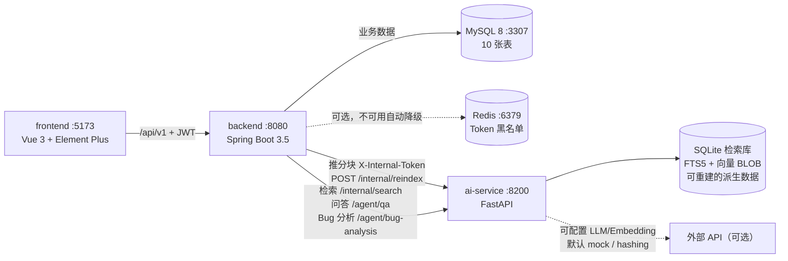

# 00 - DevPilot 项目整体介绍

> 阅读对象：Java 基础不太扎实的本科生。这篇先讲清楚"DevPilot 是什么、为什么要这样搭"，后面 6 篇再逐个深入。
> 本文只陈述事实，凡是没有在本机验证过的地方都会明确标注。

## 1. 项目是什么

DevPilot 是一个**自托管的 AI 研发协作平台**（MVP 版本）。它把下面这条工作流串在同一个系统里：

```
导入代码仓库(zip / 公开 Git URL) → 解析过滤 → 分块入库 → 建立检索索引
        → 关键词/语义/混合检索 → AI 问答与 Bug 根因分析(带代码证据)
        → 分析结论转缺陷任务 → 状态流转 → 仪表盘统计
```

解决的核心问题（来自 `docs/PRD.md` 第 1 节，这里不复述原文，只做归纳）：

1. **代码知识只在老成员脑子里**：新人搜"上传校验逻辑在哪"，系统能按 文件路径 + 行号 + 代码片段 回答，而不是让新人逐个问人。
2. **Bug 定位靠猜**：把一段 `NullPointerException` 堆栈贴进去，系统给出可疑代码位置、原因和证据。
3. **缺陷管理与分析割裂**：AI 分析结果可以直接关联缺陷任务，状态流转由服务端校验。
4. **重型方案用不起**：Sourcegraph/Copilot Enterprise 贵且部署重；DevPilot 定位是小团队自托管、数据不出内网、**无外网/无 API Key 也能跑**（mock 模式 + hashing 向量降级）。

一句话定位（PRD 原话）：**让"检索代码、分析 Bug、跟踪缺陷"在同一个平台里完成，且每条 AI 结论都附带可核对的代码证据。**

## 2. 三个组成部分以及它们如何协作

仓库分三个服务目录 + 若干支撑目录：

| 目录 | 技术栈 | 端口 | 职责 |
|---|---|---|---|
| `backend/` | Java 21 + Spring Boot 3.5.16（见 `backend/pom.xml`） | 8080 | 业务与数据的**唯一权威**：认证、项目、仓库导入、分块、关键词检索、缺陷、仪表盘；MySQL 是 source of truth |
| `ai-service/` | Python + FastAPI（见 `ai-service/requirements.txt`） | 8200 | 无状态检索与推理引擎：SQLite FTS5 + 向量双通道检索、Agent 问答/Bug 分析工作流、可插拔 LLM/Embedding Provider |
| `frontend/` | Vue 3 + Element Plus + Pinia + Vite（见 `frontend/package.json`） | 5173 | 中后台界面，开发模式通过 Vite 代理 `/api` 到 8080（见 `frontend/vite.config.ts`） |

三者的调用关系（`docs/ARCHITECTURE.md` 第 1 节同款结构，此处简化）：



关键协作约定（都写在 `docs/API_CONTRACT.md`）：

- 前端 ↔ 后端：`Authorization: Bearer <JWT>`，统一响应 `{code, message, data}`。
- 后端 ↔ Python：请求头 `X-Internal-Token`（两边的默认值都是 `dev-internal-token`，分别配置在 `backend/src/main/resources/application.yml` 的 `devpilot.ai.internal-token` 与 `ai-service/app/config.py` 的 `internal_token`）。
- **职责边界**：Java 管业务与持久化；Python 不连 MySQL，只维护"可以随时删掉重建"的 SQLite 索引。Python 挂了，关键词检索和缺陷管理照常工作（详见 06 篇）。

### 2.1 故障时的表现矩阵（提前有一个全局印象）

架构文档把这叫"诚实降级"——不是每个组件挂了系统都跟着挂，但**降级了必须明说**：

| 故障场景 | 用户看到什么 | 原因在哪 |
|---|---|---|
| Python 服务没启动 | 关键词检索正常；语义/混合检索自动降级为关键词且响应里 `vectorEnabled=false`；AI 问答报"AI 服务不可用" | `SearchService` catch 上游异常转关键词；`AiIndexClient` 抛 50200 |
| 外部大模型没配 Key/网络不通 | 问答/分析明确报错；或管理员切 `LLM_PROVIDER=mock`，前端显示"演示模式" | `ai-service/app/llm.py` 的 Provider 抽象 |
| Embedding 不可用 | 语义通道自动关闭，仅关键词可用，`vectorEnabled=false` | `ai-service/app/embeddings.py` 的 `EmbeddingUnavailable` |
| Redis 没装 | 无感，启动日志一行 WARN；黑名单退化为进程内实现 | `TokenBlacklistConfig` |
| 重复点"索引"按钮 | 第二次请求收到 409"已有进行中的索引任务" | `index_task.active` 唯一索引（04 篇） |

### 2.2 术语表（后文会反复出现）

| 术语 | 一句话解释 | 在本项目里的位置 |
|---|---|---|
| JWT | 登录后发的"签名身份证"，服务器验签即认账，无需存会话 | `backend/src/main/java/com/devpilot/security/JwtService.java` |
| BCrypt | 密码单向摘要算法，存库的是 hash 不是明文 | `SysUser.passwordHash` |
| chunk（分块） | 把一个源文件按约 60 行切成的小段，是检索单元 | `module/indexing/Chunker.java`、`code_chunk` 表 |
| FULLTEXT(ngram) | MySQL 全文索引，ngram 把中文切成两字一组解决分词 | `V1__init.sql` 的 `code_chunk.ft_content` |
| FTS5 | SQLite 的全文检索扩展，Python 侧的关键词通道 | `ai-service/app/store.py` |
| embedding（向量） | 把文本变成一串数字（向量），语义相近的文本向量距离近 | `ai-service/app/embeddings.py` |
| RRF | 两路检索结果融合排序的算法（按名次倒数相加） | `ai-service/app/retrieval.py` |
| RAG | 先检索后生成：让大模型只依据检索到的证据回答 | `ai-service/app/workflow.py` |
| 内部 Token | Java 与 Python 互相调用的共享口令（区别于用户 JWT） | `X-Internal-Token` 请求头 |
| 状态机 | 缺陷/索引任务的合法状态流转表，服务端强制校验 | `DefectService.TRANSITIONS`、`index_task.status` |
| 软删除 | `deleted=1` 标记删除，数据还在库里 | `user/project/repository/defect` 表 |

## 3. 目录结构总览

```
devpilot/
├── backend/                    Java 后端（Maven 单模块）
│   ├── pom.xml                 Spring Boot 3.5.16 / Java 21 / MyBatis-Plus 3.5.17 / jjwt 0.13.0
│   └── src/main/java/com/devpilot/
│       ├── common/             统一响应、错误码、异常、Security/Async/MyBatis-Plus 配置
│       ├── security/           JwtService、JwtAuthFilter、SecurityUtils、TokenBlacklist
│       └── module/             auth / user / project / indexing / search / ai / defect / stats
│   └── src/main/resources/
│       ├── application.yml     端口 8080、MySQL 127.0.0.1:3307/devpilot、JWT、AI 服务地址
│       └── db/migration/       Flyway 脚本 V1__init.sql（10 张表）
├── ai-service/                 Python AI 服务
│   ├── requirements.txt        fastapi / uvicorn / pydantic / httpx / pytest
│   ├── app/                    main.py, store.py, retrieval.py, workflow.py, embeddings.py, llm.py, guard.py, validate.py
│   ├── tests/                  pytest 测试（6 个文件 31 个用例）
│   └── data/                   SQLite 索引库目录（派生数据，可删除重建）
├── frontend/                   Vue 3 前端（Vite + Element Plus + Pinia）
│   └── src/views, src/api ...  
├── scripts/
│   ├── e2e_flow.py             端到端流程验证（18 项检查）
│   └── demo_seed.py            演示数据种子脚本（admin 登录后造一套演示项目）
├── fixtures/
│   ├── demo-repo-src/          演示用源码（demo-task-app）
│   └── demo-repo.zip           上传导入用的压缩包
├── docker-compose.yml          mysql/redis/ai-service/backend/frontend 五个容器（本机未验证，见下）
├── docs/                       PRD / ARCHITECTURE / DATABASE / API_CONTRACT / AI_WORKFLOW + 本 learning 目录
└── .env.example                环境变量样例
```

## 4. 一条最短的可运行路径（预习）

本机开发的最小依赖是：JDK 21 + Maven + Python 3 + Node 22 + 一个 MySQL 实例（3307 端口）。Redis 不是必需的——`backend/src/main/java/com/devpilot/common/config/TokenBlacklistConfig.java` 在 Redis 连不上时会降级为进程内黑名单并打 WARN 日志。

```bash
# 1) MySQL 起一个 3307 实例，建库 devpilot / devpilot_test（见 01 篇）
# 2) 后端
cd backend && mvn spring-boot:run        # 首次启动 Flyway 自动建表，并创建 admin 账号
# 3) AI 服务
cd ai-service && pip install -r requirements.txt
python -m uvicorn app.main:app --port 8200
# 4) 前端
cd frontend && npm install && npm run dev   # http://localhost:5173
```

演示账号：`admin / admin123456`（由 `UserController` 的 `ApplicationRunner` 引导创建，默认密码只用于本地演示，启动日志会显著告警）。

### 4.1 一次完整的用户旅程（对照三个服务）

以"新成员小李搜一段业务逻辑，然后跟踪由此产生的缺陷"为例，整条链路经过的模块：

| 步骤 | 用户动作 | 接口（`docs/API_CONTRACT.md`） | 谁在干活 |
|---|---|---|---|
| 1 | 注册、登录 | `POST /api/v1/auth/register`、`/auth/login` | backend `module/auth`，签发 JWT |
| 2 | 建项目 | `POST /api/v1/projects` | backend `module/project` |
| 3 | 上传 zip 或填 Git URL | `POST .../repositories/upload`、`/repositories/git` | `ImportService` 安全过滤后落库 |
| 4 | 点"开始索引" | `POST /api/v1/repositories/{id}/index-tasks` | `IndexTaskService` 建任务，`AsyncIndexRunner` 异步跑流水线 |
| 5 | 等待索引完成 | 轮询 `GET /api/v1/index-tasks/{id}` | 任务状态机 PENDING→RUNNING→SUCCESS |
| 6 | 搜 "completeTask" | `GET /api/v1/search?q=...&mode=keyword` | backend 查 MySQL FULLTEXT；`mode=hybrid` 时 Python 参与 |
| 7 | 问 "完成任务逻辑在哪" | `POST /api/v1/projects/{id}/ai/qa` | backend `module/ai` → Python `workflow.run_qa` → 落 `ai_analysis` |
| 8 | 分析转缺陷 | `POST .../defects`（带 `analysisId`） | backend `module/defect`，状态机接管后续流转 |
| 9 | 流转/评论缺陷 | `POST /api/v1/defects/{id}/status`、`/comments` | 服务端校验非法流转（409） |
| 10 | 看仪表盘 | `GET /api/v1/stats/dashboard` | backend `module/stats`，全部真实 SQL 统计 |

`scripts/e2e_flow.py` 把上面 1-10 步全部自动化了（18 项断言），是理解系统的最好入口之一。

## 5. 已验证的事实与未验证的部分（诚实声明）

**已验证**（在文档作者的 Windows 本机，2026-10）：

- 后端 `mvn test`：20 个用例全部通过。测试连的是本机 MySQL `devpilot_test` 库（3307 端口，配置在 `backend/src/test/resources/application-test.yml`）。构成：`AuthPermissionIntegrationTest` 7 个 + `DefectFlowIntegrationTest` 5 个 + `RepositoryIndexSearchIntegrationTest` 2 个 + `ChunkerTest` 6 个。
- Python `pytest`：31 项全部通过（test_api 3 + test_retrieval 4 + test_guard 5 + test_store 5 + test_validate 8 + test_workflow 6）。
- E2E：`python scripts/e2e_flow.py` 18 项检查全部 PASS（覆盖注册/登录/建项目/上传/索引/检索/AI 问答/Bug 分析/缺陷流转/越权拦截/仪表盘）。
- 三个服务在本机（8080 / 8200 / 5173）联合启动并跑通上述 E2E。

**设计完成但本机未验证**：

- `docker-compose.yml` 的五个容器一键部署路径（Dockerfile 在 `docker/` 目录）。compose 文件本身与 `application.yml`、`.env.example` 的变量是对齐的，但没有在本机实际 `docker compose up` 跑过。
- 真实 LLM / 真实 Embedding Provider（`LLM_PROVIDER=openai`、`EMBEDDING_PROVIDER=openai`）的调用质量：本机验证全部使用 mock LLM + hashing embedding。

## 6. 如何阅读本学习目录

| 篇 | 内容 | 适合什么时候读 |
|---|---|---|
| 00（本篇） | 项目是什么、三服务如何协作 | 最先读 |
| 01-开发环境搭建 | Windows 下装 JDK21/Maven/Python/Node/MySQL8，3307 独立实例 | 装环境时 |
| 02-项目启动与调试 | 三个服务的启动命令、演示账号、Swagger、断点建议 | 第一次跑起来 |
| 03-Java后端架构详解 | 模块化单体、统一响应/异常、一次请求的生命周期、异步线程池 | 读后端源码前 |
| 04-数据库设计详解 | 10 张表逐表讲解、active 唯一索引防并发、FULLTEXT(ngram)、Flyway | 读 SQL/实体时 |
| 05-认证与权限详解 | JWT 全流程、BCrypt、登录限流、双层鉴权、越权测试 | 读 security 包时 |
| 06-RAG检索流程详解 | 分块→推送→SQLite 双通道→RRF 融合→降级语义 | 读 indexing/search/ai-service 时 |

建议配合真实代码对照阅读，每篇给出的类名、方法名都可直接在仓库里搜索定位。

### 6.1 `docs/` 下其余文档的分工

本学习目录是"教学口吻的导览"，`docs/` 根目录下还有五份"工程口径"的正式文档，遇到细节分歧时以它们为准：

| 文件 | 回答什么问题 | 什么时候查 |
|---|---|---|
| `docs/PRD.md` | 项目要做什么、P0 范围、明确不做什么 | 怀疑"这个功能到底有没有"时 |
| `docs/ARCHITECTURE.md` | 三服务怎么划分、技术选型理由、降级矩阵 | 改架构或讲不清楚"为什么这样设计"时 |
| `docs/DATABASE.md` | 表清单、约束、设计决策 | 改表或写 SQL 前 |
| `docs/API_CONTRACT.md` | 全部接口的字段级契约、错误码 | 前后端联调、写脚本时 |
| `docs/AI_WORKFLOW.md` | Python Agent 的 8 步流水线与注入防护 | 深入 `ai-service/app/workflow.py` 前 |

### 6.2 自测：什么时候可以认为你"入门"了

不必背代码，能独立回答下面 6 个问题就算入门（答案分别在本目录的 03/04/05/06 篇）：

1. 前端请求 `GET /api/v1/projects` 时，Java 后端从进请求到出响应经过了哪些组件？
2. 为什么两个用户同时点"开始索引"，数据库里只会有一条进行中的任务？
3. 新用户 B 登录后直接拿项目 ID 访问用户 A 的项目，哪一层拦住了他？怎么证明？
4. 搜中文"任务"为什么能命中代码注释？两条检索通道分别建在哪、谁维护？
5. ai-service 进程被杀掉后，哪些功能受影响、哪些不受？系统如何"明说"降级？
6. 本项目怎么区分"真实模型"和"演示模式"？这个区分存在哪里？

答不上来没关系——带着问题往下读，读完对应篇章再回来对一遍即可。

> 本学习目录由项目文档作者维护，基于 2026-10 的代码快照撰写；代码后续演进时，以仓库内真实源码为准，本目录负责给你指出"去哪里看、为什么这样设计"。
