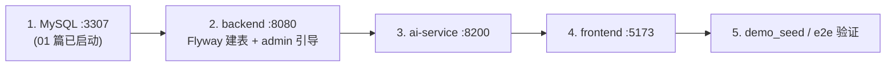

# 02 - 项目启动与调试

> 前置：01 篇的环境已就绪（JDK21 / Maven / Python3.11 / MySQL 3307 两个空库）。
> 本篇所有命令都在仓库根目录 `devpilot/` 下相对书写；Windows 下用 Git Bash 或 cmd 均可（命令按 Git Bash 风格写，cmd 里把 `export` 换成 `set`）。

## 1. 启动顺序与总览

三个服务没有严格的启动顺序依赖（backend 连不上 AI 服务时会降级，AI 服务不连 MySQL），但为了第一次就跑通完整链路，建议按 backend → ai-service → frontend 的顺序启动：



## 2. 启动 backend（Java，8080）

```bash
cd backend
# 确认 JAVA_HOME 指向 JDK21（01 篇），Maven 启动失败多半是它
echo $JAVA_HOME
mvn spring-boot:run
```

首次启动会发生三件事（看控制台就能确认）：

1. **Flyway 迁移**：对 `devpilot` 库执行 `V1__init.sql`，建出 10 张表。日志关键字 `Migrating schema \`devpilot\` to version "1 - init"`。
2. **管理员引导**：`backend/src/main/java/com/devpilot/module/user/UserController.java` 实现了 `ApplicationRunner`，`run()` 方法发现库里没有任何 ADMIN 时，按 `application.yml` 的 `devpilot.admin.bootstrap-username/password` 创建账号。默认即 `admin / admin123456`。使用默认密码时控制台会打出醒目的多行警告。
3. **TokenBlacklist 探测**：有 Redis 就用 Redis；没有则 WARN 一行并降级为进程内实现（不影响启动）。

启动成功的标志：日志出现 `Started DevPilotApplication`，且 `curl http://127.0.0.1:8080/actuator/health` 返回 `{"status":"UP",...}`。

日志同时写入 `backend/logs/devpilot-backend.log`（`application.yml` 的 `logging.file.name`）。

## 3. 启动 ai-service（Python，8200）

```bash
cd ai-service
python -m venv .venv              # 第一次才需要
.venv/Scripts/activate            # Windows；Linux/Mac 是 .venv/bin/activate
pip install -r requirements.txt   # 第一次才需要
python -m uvicorn app.main:app --port 8200
```

说明：

- 入口是 `ai-service/app/main.py` 的 `app` 对象（FastAPI 实例）。
- `--port 8200` 必须与 backend 的 `devpilot.ai.base-url`（默认 `http://127.0.0.1:8200`）对上。
- 默认 `LLM_PROVIDER=mock`、`EMBEDDING_PROVIDER=hashing`（见 `ai-service/app/config.py`），不联网、不要 API Key。
- 健康检查：`curl http://127.0.0.1:8200/health` 应返回 `{"status":"UP","llm_provider":"mock","embedding_provider":"hashing","vector_ready":true}`。

## 4. 启动 frontend（Vue，5173）

```bash
cd frontend
npm install      # 第一次才需要
npm run dev
```

- 打开 `http://localhost:5173`。`frontend/vite.config.ts` 把 `/api` 代理到 `http://127.0.0.1:8080`，所以本地开发不用关心跨域。
- `package.json` 里其他脚本：`npm run build`（含 vue-tsc 类型检查）、`npm run test`（vitest）。

## 5. 登录与演示数据

1. 浏览器打开 `http://localhost:5173`，用 **admin / admin123456** 登录。
2. 想要一套"像样"的演示数据（一个项目 + 演示代码仓库 + 索引完成 + 一次 AI 问答 + 一次 Bug 分析 + 三个不同状态的缺陷），跑：

```bash
python scripts/demo_seed.py
```

脚本行为（见 `scripts/demo_seed.py`）：以 admin 登录 → 创建 `demo-task-app（演示 MMDD-HHMM）` 项目 → 上传 `fixtures/demo-repo.zip` → 触发索引并轮询到终态 → 发起一次 AI 问答和一次 Bug 分析 → 建 3 个缺陷（1 个处理中、1 个待处理、1 个已解决）。脚本是**幂等友好**的：重复执行会创建新的演示项目，不会破坏旧数据。

前端各页面操作的接口对应关系可查 Swagger（下一节）或 `docs/API_CONTRACT.md`。

### 5.1 最小闭环：10 分钟用命令行走一遍核心链路

不想先开前端的话，用 curl（或 Swagger）就能把"上传→索引→检索→问答→缺陷"走通，对理解系统很有帮助。Windows 的 Git Bash 下：

```bash
BASE=http://127.0.0.1:8080/api/v1

# 1) 登录拿 Token
TOKEN=$(curl -s -X POST $BASE/auth/login -H "Content-Type: application/json" \
  -d '{"username":"admin","password":"admin123456"}' | python -c "import sys,json;print(json.load(sys.stdin)['data']['accessToken'])")
AUTH="Authorization: Bearer $TOKEN"

# 2) 建项目
curl -s -X POST $BASE/projects -H "$AUTH" -H "Content-Type: application/json" \
  -d '{"name":"hello-devpilot","description":"我的第一个项目"}'
# 记下返回 data.id，假设是 1

# 3) 上传演示压缩包（fixtures/demo-repo.zip，没有就先跑 fixtures/build_fixture.py）
curl -s -X POST $BASE/projects/1/repositories/upload -H "$AUTH" \
  -F "file=@fixtures/demo-repo.zip" -F "name=demo-task-app"

# 4) 触发索引（记下返回的 task id，假设是 1），然后轮询
curl -s -X POST $BASE/repositories/1/index-tasks -H "$AUTH"
curl -s $BASE/index-tasks/1 -H "$AUTH"     # status 变 SUCCESS 即完成，留意 active 字段

# 5) 关键词检索
curl -s "$BASE/search?repositoryId=1&q=completeTask&mode=keyword" -H "$AUTH"

# 6) 混合检索（走 Python，注意响应里的 vectorEnabled）
curl -s "$BASE/search?repositoryId=1&q=完成任务&mode=hybrid" -H "$AUTH"

# 7) AI 问答（mock 模式，秒回；答案必须带 evidence）
curl -s -X POST $BASE/projects/1/ai/qa -H "$AUTH" -H "Content-Type: application/json" \
  -d '{"repositoryId":1,"question":"完成任务的业务逻辑在哪个文件？"}'

# 8) 建一个缺陷并流转一次
curl -s -X POST $BASE/projects/1/defects -H "$AUTH" -H "Content-Type: application/json" \
  -d '{"title":"示例缺陷","severity":"MAJOR","priority":"P1"}'
curl -s -X POST $BASE/defects/1/status -H "$AUTH" -H "Content-Type: application/json" \
  -d '{"status":"IN_PROGRESS"}'
```

每一步的响应都是 `{code, message, data}`。哪一步报错，就对照 `code`（40001 参数 / 40100 未认证 / 40300 越权 / 40400 不存在 / 40900 冲突 / 50200 AI 服务不可用）定位。这条链路跑通，说明三个服务协作正常，E2E 脚本（第 7 节）只是在它之上加了自动化断言。

## 6. Swagger 与健康检查地址

| 地址 | 内容 |
|---|---|
| `http://127.0.0.1:8080/swagger-ui.html` | springdoc 生成的全部接口，可直接发请求（右上角 Authorize 填 `Bearer <token>`） |
| `http://127.0.0.1:8080/v3/api-docs` | OpenAPI JSON |
| `http://127.0.0.1:8080/actuator/health` | 后端健康 |
| `http://127.0.0.1:8200/health` | AI 服务健康（含 llmProvider/embeddingProvider） |

Swagger 里调接口的最短路径：`POST /api/v1/auth/login`（body `{"username":"admin","password":"admin123456"}`）拿 `accessToken` → 右上角 Authorize 里粘贴这个 Token（OpenApiConfig 定义的是 HTTP bearer 方案，**只需粘纯 Token，Swagger UI 会自动加 `Bearer ` 前缀**）→ 之后所有接口的"Try it out"都会带上认证头。

## 7. 测试三件套（本机验证过的事实）

```bash
# ① 后端测试：20 个用例，全部通过（需 devpilot_test@3307 存在）
cd backend && mvn test

# ② AI 服务测试：31 项，全部通过
cd ai-service && pytest

# ③ 端到端：backend + ai-service 都启动后执行，18 项检查全部 PASS
python scripts/e2e_flow.py
```

- ①连的是 `backend/src/test/resources/application-test.yml` 里配置的 `jdbc:mysql://127.0.0.1:3307/devpilot_test`（可用 `TEST_DB_USERNAME`/`TEST_DB_PASSWORD` 覆盖账号）。`mvn test` 期间 Flyway 会把测试库也迁移好，无需手工干预。
- ③的逻辑：注册临时用户 → 登录 → 建项目 → 上传 `fixtures/demo-repo.zip` → 触发索引并轮询 → 关键词/中文/混合检索 → AI 问答（断言必须带证据）→ Bug 分析 → 建缺陷 → 三步状态流转 → 非法流转拒绝(409) → 另一用户越权访问拒绝(403) → 仪表盘统计。18 项每一项对应脚本里一次 `step(...)` 输出，结尾打印 `结果：PASS=18 FAIL=0`。

## 8. 断点调试建议

### 8.1 Java 侧（IDEA）

`mvn spring-boot:run` 调试模式启动：

```bash
mvn spring-boot:run -Dspring-boot.run.jvmArguments="-agentlib:jdwp=transport=dt_socket,server=y,suspend=n,address=*:5005"
```

然后 IDEA 里 Run → Attach to Process / Remote JVM 连 `127.0.0.1:5005`。值得打断点的位置（按请求流经顺序）：

| 断点位置 | 观察什么 |
|---|---|
| `security/JwtAuthFilter.doFilterInternal` | Token 怎么被解析、黑名单怎么拦、SecurityContext 怎么写入 |
| `module/auth/AuthService.login` | BCrypt 匹配、失败限流队列 `failedLogins` 的变化 |
| `module/project/ProjectService.requireAccessible` | 数据级鉴权：owner 比对、admin 放行 |
| `module/indexing/AsyncIndexRunner.executeTask` | 索引流水线（注意：这是 `@Async` 线程，不是 HTTP 线程，见下） |
| `module/search/SearchService.search` | 关键词/降级逻辑、结果合并排序分页 |
| `common/exception/GlobalExceptionHandler` | 异常怎么变成 `{code,message}` 响应 |

两个容易困惑的点：

1. **异步线程**：`AsyncIndexRunner.executeTask` 由 `common/config/AsyncConfig.java` 的 `indexExecutor`（核心 2、最大 4、队列 50，线程名前缀 `index-task-`）执行。在 IDEA 里断下后看调用栈，会发现栈顶不是 Tomcat 线程——触发索引的 HTTP 请求在 `IndexTaskService.createTask` 调用 `runner.executeTask(...)` 后就返回了，真正干活的是线程池里的线程。
2. **过滤器 vs Controller**：401/403 有两种来源——Security 过滤链直接拒绝（`SecurityConfig` 里的 `authenticationEntryPoint` / `accessDeniedHandler`，不会进 Controller），以及 Service 抛 `BizException` 被 `GlobalExceptionHandler` 转 JSON。调试时注意看请求到底死在哪一层。

### 8.2 Python 侧

VS Code / PyCharm 对 `ai-service` 目录用 uvicorn 调试配置（`python -m uvicorn app.main:app --port 8200 --reload`），在 `app/retrieval.py` 的 `search()`（RRF 融合）和 `app/workflow.py`（Agent 8 步流水线）打断点收益最大。

### 8.3 数据库侧

用任意客户端连 `127.0.0.1:3307 root(空密码)`：

- `SELECT * FROM index_task ORDER BY id DESC LIMIT 5;` 观察任务状态机与 `active` 列的变化（进行中=1，终态=NULL）。
- `SELECT status, COUNT(*) FROM defect GROUP BY status;` 对照仪表盘数字。

## 9. 常见问题

| 症状 | 原因与处理 |
|---|---|
| 后端启动报 `Access denied for user 'root'` | 3307 实例不是 `--initialize-insecure` 初始化的（root 有密码），或设了 `DB_PASSWORD` 没对应 |
| 后端启动报 `Unknown database 'devpilot'` | 01 篇第 6.4 步没建库；Flyway 只建表不建库 |
| 索引一直 PENDING/RUNNING 不动 | 看 `backend/logs/devpilot-backend.log` 里 `index-task-` 线程日志；多为 AI 服务没启动（任务会 FAILED，但文件/关键词检索不受影响，见 06 篇） |
| 检索选 semantic/hybrid 报"AI 服务不可用" | ai-service 没起；`SearchService` 会自动降级为关键词检索，且响应里 `vectorEnabled=false` |
| 前端登录请求 401 | backend 没起（Vite 代理打不通也会这样）；或 Token 过期（默认 120 分钟，见 `devpilot.jwt.expire-minutes`） |
| `mvn test` 报连不上 devpilot_test | 01 篇只建了 `devpilot`，测试库 `devpilot_test` 也要建 |

## 10. 日志与实时观察

| 观察 | 位置/命令 | 看什么 |
|---|---|---|
| 后端日志文件 | `backend/logs/devpilot-backend.log`（`application.yml` 的 `logging.file.name`） | 启动期看 Flyway 迁移与黑名单降级 WARN；运行期看 `index-task-` 线程的索引流水线 INFO |
| 后端实时跟踪 | `tail -f backend/logs/devpilot-backend.log`（Git Bash） | 触发索引时观察"导入→事务替换→推送 Python→SUCCESS"的时序 |
| AI 服务日志 | uvicorn 前台控制台 | `/internal/reindex` 的 `vector_enabled` 与 embedding 降级 WARNING |
| MySQL 侧验证 | 任意客户端连 3307 | `SELECT id,status,active FROM index_task ORDER BY id DESC;`（04 篇） |
| 前端请求 | 浏览器 F12 Network | 5173 → `/api/...` 由 Vite 代理到 8080；看真实响应里的 `code` 与 `data` |

日志级别默认 INFO（`logging.level.com.devpilot: INFO`）。想看 JWT 过滤器对每个请求的决策细节，可临时把 `com.devpilot.security` 调到 DEBUG，但不要提交这个改动。
