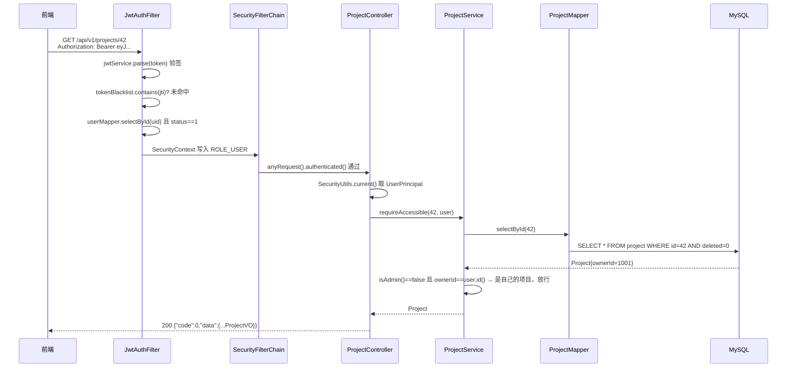

# 03 - Java 后端架构详解

> 读这篇之前建议先把 02 篇的 backend 跑起来。本篇所有类都在 `backend/src/main/java/com/devpilot/` 下（下文省略此前缀）。

## 1. 为什么是"模块化单体"而不是微服务

三个服务的分工（00 篇讲过）里，backend 自己内部**没有**再拆成多个可独立部署的应用，而是按业务垂直切成 8 个包，放在同一个 Spring Boot 进程里。理由写在 `docs/ARCHITECTURE.md`：团队规模与流量不需要微服务，单体内把模块边界划清楚，将来要拆也拆得动。

对小团队/MVP，微服务的成本（注册中心、网关、分布式事务、多份运维）远大于收益。这不是偷懒，是选型表里明确比较过的结论（同文档第 3 节）。

## 2. 包结构与依赖方向

```
com.devpilot
├── DevPilotApplication.java            启动类
├── common/
│   ├── api/       ApiResponse / ErrorCode / PageResult
│   ├── config/    SecurityConfig / AsyncConfig / MybatisPlusConfig /
│   │              TokenBlacklistConfig / OpenApiConfig / WebConfig / AppProperties
│   └── exception/ BizException / GlobalExceptionHandler
├── security/      JwtService / JwtAuthFilter / SecurityUtils / UserPrincipal / TokenBlacklist
└── module/
    ├── auth/      AuthController / AuthService + dto        注册/登录/登出、登录失败限流
    ├── user/      UserController / UserService / SysUser    用户管理(仅ADMIN)、/users/me
    ├── project/   ProjectController / ProjectService / RepositoryService   项目 CRUD、归属校验
    ├── indexing/  IndexController / IndexTaskService /
    │              ImportService / AsyncIndexRunner / Chunker / CodeFile / CodeChunk
    │              导入安全过滤、分块、索引任务状态机
    ├── search/    SearchController / SearchService           关键词(FULLTEXT)与语义/混合检索入口
    ├── ai/        AiController / AiAnalysisService /
    │              AiIndexClient + dto                        AI 问答/Bug 分析编排，调 Python
    ├── defect/    DefectController / DefectService          缺陷状态机
    └── stats/     StatsController / StatsService            仪表盘聚合
```

（`ImportService` 按职责与 indexing 模块强相关，实际放在 `module/indexing/` 包。）

**依赖方向规则**（这是模块化单体的核心纪律）：

1. `common` 和 `security` 是底座，所有人可以用它们，它们不依赖任何 `module`。唯一例外：`JwtAuthFilter` 会用 `module/user/mapper/SysUserMapper` 加载用户——这是"认证需要读用户表"这一客观需求造成的向上依赖，改法可以是把 user 挪到底座，MVP 选择容忍并注释说明。
2. `module` 之间**只允许调用对方的 Service**，不允许跨模块注入别人的 Mapper。例如 `DefectService` 需要"判断当前用户能不能访问某项目"，调的是 `ProjectService.requireAccessible(...)`，而不是自己写一条查 project 表的 SQL。
3. Controller 不写业务：只做参数校验（`@Valid`）、取当前用户（`SecurityUtils.current()`）、调 Service、包一层 `ApiResponse.ok(...)`。业务规则（权限、状态机、事务）全部在 Service。

用一张图表达允许的依赖（→ 表示"可以调用"）：

```
Controller ──→ 本模块 Service ──→ 本模块 Mapper ──→ MySQL
                  │  ↑
                  │  └── 其他模块 Service（跨模块唯一合法通道）
                  └─────→ common（ApiResponse/BizException/配置）
一切请求先流经：security.JwtAuthFilter（底座，对所有 module 生效）
```

## 3. 统一响应与异常处理链路

### 3.1 为什么需要统一

前端不应该面对两种 JSON 格式。DevPilot 约定所有接口返回：

```json
{ "code": 0, "message": "ok", "data": { } }
```

`code=0` 成功；非 0 失败，且 HTTP 状态码与 code 同时表达（例如 403 + 40300）。

### 3.2 三个关键类

- `common/api/ApiResponse.java`：一个 Java record，`ApiResponse.ok(data)` / `ApiResponse.of(ErrorCode, message)` 两个工厂方法。
- `common/api/ErrorCode.java`：枚举，同时定义业务 code 和 HTTP 状态。真实值：`BAD_REQUEST(40001,400)`、`UNAUTHORIZED(40100,401)`、`FORBIDDEN(40300,403)`、`NOT_FOUND(40400,404)`、`CONFLICT(40900,409)`、`TOO_MANY_REQUESTS(42900,429)`、`SYSTEM_ERROR(50000,500)`、`UPSTREAM_ERROR(50200,502)`。
- `common/exception/BizException.java`：业务异常，携带 ErrorCode。提供 `BizException.conflict("...")`、`notFound(...)`、`forbidden(...)`、`badRequest(...)` 静态工厂，Service 里到处是 `throw BizException.conflict("同名项目已存在")` 这样的写法。

### 3.3 异常到响应的转换：GlobalExceptionHandler

`common/exception/GlobalExceptionHandler.java` 是一个 `@RestControllerAdvice`——Spring 会把所有 Controller 抛出的异常先路由到这里。按"最具体优先"匹配：

| 异常 | 处理结果 |
|---|---|
| `BizException` | 用异常自带的 ErrorCode 翻译成状态码 + 消息（**业务错误的标准出口**） |
| `MethodArgumentNotValidException` / `BindException` | 40001，`data` 里是 `{字段名: 错误信息}` 明细 |
| `MaxUploadSizeExceededException` | 40001，提示"上传文件过大（单包上限 100MB）" |
| `DuplicateKeyException` | 40900，"数据唯一性冲突（名称重复或任务重复提交）"——数据库唯一索引兜底的用户可读翻译 |
| `DataIntegrityViolationException` | 40900，外键等完整性冲突 |
| `AccessDeniedException` | 40300（`@PreAuthorize` 拒绝时走这里） |
| `NoResourceFoundException` | 40400 |
| 其他一切 `Exception` | 50000，**对外固定说"系统繁忙，请稍后重试"**，真实堆栈只进日志 |

最后一条是刻意的：不把内部异常消息（可能含 SQL、路径）泄漏给前端。

### 3.4 一条完整的链路示意

```
Service 抛 BizException(40900, "非法状态流转: CLOSED → OPEN")
        │
        ▼
GlobalExceptionHandler.handleBiz()
        │  ResponseEntity.status(409)
        ▼
HTTP 409  ←  {"code":40900,"message":"非法状态流转: CLOSED → OPEN（允许: 无，已终态）","data":null}
```

这条链路在 E2E 里被真实验证过：`scripts/e2e_flow.py` 第 15 项断言对 CLOSED 缺陷再流转 OPEN 时 `resp.status_code == 409`。

## 4. 一次 HTTP 请求的完整生命周期

以"普通用户 小王 查看自己的某个项目详情"（`GET /api/v1/projects/42`）为例：



逐层拆开：

1. **JwtAuthFilter**（`security/JwtAuthFilter.java`）：继承 `OncePerRequestFilter`，每个请求执行一次。关键设计——**解析失败不抛异常**，请求以匿名身份继续走后面的授权规则，由授权规则统一给 401。这样过滤器逻辑极简，且不存在"过滤器里异常格式不一致"的问题。它做四件事：验签、查黑名单（登出的 Token 拒绝）、查用户表确认账号仍启用（禁用后已签发 Token 立即失效）、把 `UserPrincipal` + `ROLE_角色` 写进 SecurityContext。
2. **SecurityFilterChain**（`common/config/SecurityConfig.java`）：路由级授权在 `authorizeHttpRequests` 里声明——`/api/v1/auth/login|register`、`/actuator/health`、`/swagger-ui.html`、`/error` 放行；`/api/v1/admin/**` 要求 `hasRole("ADMIN")`；其余 `anyRequest().authenticated()`。没登录 → `authenticationEntryPoint` 返回 401 + `{code:40100,...}`；已登录但角色不够 → `accessDeniedHandler` 返回 403。
3. **Controller**（如 `module/project/ProjectController.detail`）：`SecurityUtils.current()` 从 SecurityContext 取出 `UserPrincipal`（一个 record：`id()/username()/role()/isAdmin()`），转手交给 Service。
4. **Service**：先做**数据级鉴权**（`requireAccessible`，详见 05 篇），再做业务。
5. **Mapper**：MyBatis-Plus 的 `BaseMapper`，`selectById` 一行不用写 SQL。注意查询会自动带上 `deleted=0`——软删除是 MyBatis-Plus 的 `@TableLogic` 机制（04 篇细讲）。

理解这张图后，读任何接口的代码都按同一条路径走：Filter → 授权规则 → Controller → Service（鉴权→业务）→ Mapper。

## 5. MyBatis-Plus 配置要点

`backend/src/main/resources/application.yml`：

```yaml
mybatis-plus:
  configuration:
    map-underscore-to-camel-case: true   # Java 驼峰 createdAt ↔ 列 created_at
  global-config:
    db-config:
      id-type: auto                      # 主键交给 MySQL 自增（所有表都是 BIGINT AUTO_INCREMENT）
      logic-delete-field: deleted        # 全局软删除字段名
      logic-delete-value: 1
      logic-not-delete-value: 0
```

- `map-underscore-to-camel-case`：实体类字段 `repositoryId` 自动映射列 `repository_id`，Mapper 里不用写映射。
- `id-type: auto`：insert 后 MyBatis-Plus 会把数据库生成的主键回填到实体——`AsyncIndexRunner.insertFilesAndChunks` 里 `fileMapper.insert(file)` 之后立刻能拿到 `file.getId()` 去建分块，靠的就是这个。
- `logic-delete-field: deleted`：全项目统一软删除开关。此后 `mapper.deleteById(id)` 实际执行 `UPDATE ... SET deleted=1`，所有 select 自动追加 `deleted=0`。`code_file/code_chunk` 这类派生数据不走软删除，它们没有 `deleted` 列，用的是真删除（04 篇讲取舍）。
- 分页插件在 `common/config/MybatisPlusConfig.java`：注册 `PaginationInnerInterceptor(DbType.MYSQL)`，`selectPage(new Page<>(page,size), wrapper)` 才会生成真正的 `LIMIT ... OFFSET ...` 并回填 total。没有这个 Bean，分页查询会"看起来有 page 参数、实际一次捞全表"——这是 MyBatis-Plus 新手最常见的坑。
- 3.5.9+ 版本分页还需要 `mybatis-plus-jsqlparser` 适配构件，`backend/pom.xml` 里已单独引入（3.5.17）。

## 6. 异步线程池：AsyncConfig

`common/config/AsyncConfig.java` 全文很短，直接看：

```java
@Configuration
@EnableAsync
public class AsyncConfig {
    @Bean("indexExecutor")
    public Executor indexExecutor() {
        ThreadPoolTaskExecutor executor = new ThreadPoolTaskExecutor();
        executor.setCorePoolSize(2);
        executor.setMaxPoolSize(4);
        executor.setQueueCapacity(50);
        executor.setThreadNamePrefix("index-task-");
        executor.initialize();
        return executor;
    }
}
```

为什么索引任务要异步？一次导入+索引可能要几十秒（解压、落库几千个文件分块、推给 Python），如果同步做，HTTP 请求会挂着直到超时。做法是：`IndexTaskService.createTask` 只负责"建一条 PENDING 任务并立即返回"，然后调用 `asyncIndexRunner.executeTask(taskId)`（方法上标 `@Async("indexExecutor")`），由线程池里的 `index-task-N` 线程执行完整流水线（`module/indexing/AsyncIndexRunner.java`），前端轮询 `GET /api/v1/index-tasks/{id}` 看进度。

线程池参数的含义（以本项目的量级）：

- 核心线程 2、最大 4：索引是 IO 密集（读 zip/写 MySQL/推 HTTP），但 MVP 场景同时索引的仓库屈指可数，2~4 个线程足够，且限制了"并发索引挤爆数据库连接池"的风险（Hikari 池大小是 10，见 `application.yml` 的 `hikari.maximum-pool-size`）。
- 队列 50：任务多于线程时排队。**没有配置拒绝策略**——队列满时会抛 `TaskRejectedException`，意味着极端情况下第 51 个并发索引请求会报错，这个量级在 MVP 不会发生，属于已知且可接受的边界。
- "同一个仓库同时只有一个索引任务"不靠线程池保证，靠的是数据库唯一索引（`index_task` 的 `UNIQUE(repository_id, active)`），见 04 篇——并发防重永远交给数据库，这是本项目的固定思路。

## 7. 小结与自测

读完本篇你应该能回答：

1. 为什么 `DefectService` 里看不到查 project 表的 SQL？（跨模块只调对方 Service：`projectService.requireAccessible`）
2. 一个 `BizException.conflict(...)` 是怎么变成 HTTP 409 + `{code:40900}` 的？（GlobalExceptionHandler.handleBiz + ErrorCode 的 code/httpStatus 双值）
3. 为什么禁用一个用户后，他手里的旧 Token 立刻失效？（JwtAuthFilter 每次请求都查 `user.status==1`）
4. `selectPage` 为什么必须配合 `PaginationInnerInterceptor`？（分页插件拦截器改写 SQL 并回填 total）
5. 触发索引的 HTTP 请求为什么"秒回"？（createTask 只建 PENDING 任务，真正流水线在 `indexExecutor` 线程池异步执行）

下一篇 04 讲这些代码背后的 10 张表。
