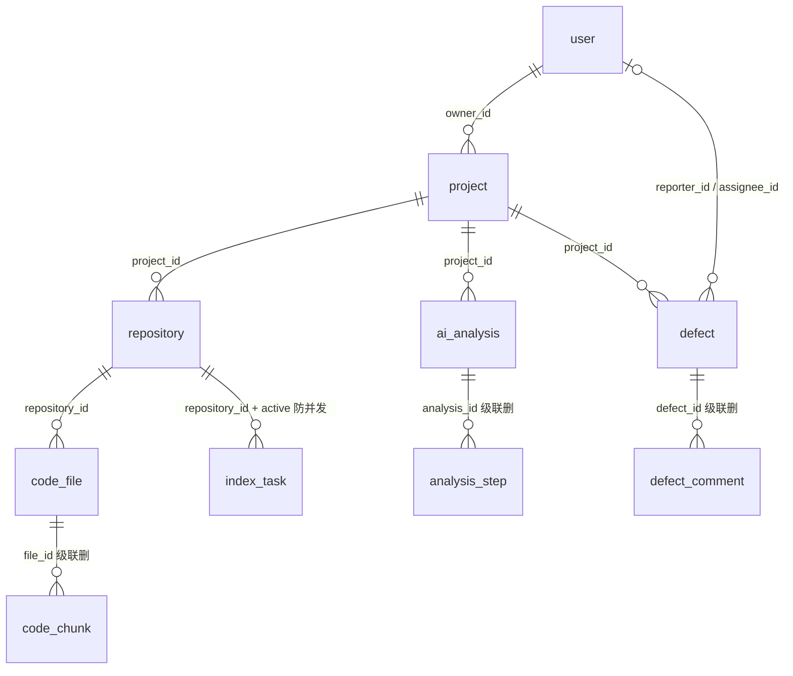

# 04 - 数据库设计详解

> 唯一的表结构权威文件是 `backend/src/main/resources/db/migration/V1__init.sql`（带注释的 DDL）。本篇逐表讲解它，并回答四个"为什么"：`active` 唯一索引怎么防并发、为什么用 FULLTEXT(ngram)、软删除/硬删除怎么取舍、Flyway 是干嘛的。
> 数据库：MySQL 8.0，库 `devpilot`（开发）/ `devpilot_test`（测试），字符集 utf8mb4。

## 1. 全局约定（先记住，后面不重复）

- **主键**：全部 `BIGINT AUTO_INCREMENT`。对外接口暴露的是这些 ID，但不依赖其连续性。
- **外键**：MVP 明确使用**物理外键**（数据规模小，优先正确性；不用外键靠应用保证一致性是大数据量下的取舍）。级联策略看表讲解。
- **时间**：每张表 `created_at`，多数还有 `updated_at`，由数据库自己维护——`DEFAULT CURRENT_TIMESTAMP` 和 `ON UPDATE CURRENT_TIMESTAMP`。这样做避免应用服务器时钟漂移，也避免忘了赋值。
- **软删除标志**：`deleted TINYINT DEFAULT 0`，只出现在"删了还想留底"的表上（见第 5 节）。
- **10 张表**：user, project, repository, code_file, code_chunk, index_task, ai_analysis, analysis_step, defect, defect_comment。

实体关系（简化版 ER）：



## 2. 逐表讲解

### 2.1 user —— 账号

| 字段 | 类型 | 说明 |
|---|---|---|
| username | VARCHAR(50) | `UNIQUE KEY uk_username`，登录名 |
| password_hash | VARCHAR(100) | **BCrypt 摘要，不存明文**（05 篇） |
| role | VARCHAR(20) | 只允许 ADMIN / USER，默认 USER |
| status | TINYINT | 1 启用 / 0 禁用；JwtAuthFilter 每次请求都会校验 |
| deleted | TINYINT | 软删除 |

### 2.2 project —— 数据隔离的顶层单元

- `UNIQUE KEY uk_owner_name (owner_id, name)`：同一个用户下项目不重名。这就是"防重名"不靠先查后插、而靠数据库兜底的实现之一（Service 里 `ProjectService.create` 先查一次给出友好提示，并发撞上唯一索引时由 `DuplicateKeyException → 40900` 兜底）。
- `owner_id` FK → user。**DevPilot 的数据隔离模型很简单：数据归属 = project.owner_id**。所有项目域数据（repository/defect/ai_analysis）都挂在 project 下面，权限检查全部收敛到 `ProjectService.requireAccessible`（05 篇）。

### 2.3 repository —— 一次代码导入

- `source_type`：GIT_URL / UPLOAD 两种来源。
- `import_status`：状态机 PENDING → PROCESSING → SUCCESS / FAILED；失败原因写 `error_message`（VARCHAR 1000），前端能直接展示"为什么导入失败"。
- `file_count / total_size / last_indexed_at`：索引成功后的汇总数字，仪表盘直接用。

### 2.4 code_file —— 文件清单与内容

- `content MEDIUMTEXT NULL`：文本内容。二进制/超限文件为 NULL，同时 `skip_reason` 记录原因（binary / too_large / unsupported / dependency_dir / sensitive）——**被过滤不等于丢失，是"有记录的跳过"**。
- 索引：`idx_repo_path (repository_id, path(191))`——按路径前缀查文件（文件清单接口的 path 过滤）；`path` 只索引前 191 字符，因为 InnoDB 索引单列长度有限制，而 path 允许到 500 字符。
- 无 `deleted` 列：它和 code_chunk 一样是**派生数据**，重新索引时整体重建（硬删除）。

### 2.5 code_chunk —— 检索单元（本库最重要的一张表）

- 代码被 `Chunker` 按每 60 行切成块（`module/indexing/Chunker.java`），每块一行记录：`chunk_index` 块序号、`start_line/end_line` 行号范围（1 起）、`content` 文本。
- `file_id` FK → code_file **ON DELETE CASCADE**：删文件连带删分块。`repository_id` 是冗余列（FK 不级联），为的是"清空某仓库全部分块"一条 SQL 搞定，不用先查文件再删。
- **`FULLTEXT KEY ft_content (content) WITH PARSER ngram`**：关键词检索的地基，第 4 节专门讲。

### 2.6 index_task —— 索引任务状态机 + 并发防重

| 字段 | 说明 |
|---|---|
| task_no | `UNIQUE KEY uk_task_no`，形如 `IDX20261025153022-4821`（`IndexTaskService.createTask` 生成：时间戳 + 随机 4 位），用于幂等追踪 |
| status | PENDING → RUNNING → SUCCESS / FAILED |
| active | TINYINT **NULL**，防并发的核心，第 3 节专讲 |
| total_files / processed_files / total_chunks | 进度数字，前端轮询展示 |
| created_by | 谁触发的（FK 语义上指向 user，V1 中未建物理外键，应用层保证） |

### 2.7 ai_analysis + analysis_step —— AI 分析留痕

- ai_analysis 一行 = 一次问答或一次 Bug 分析。`type` 区分 QA / BUG_ANALYSIS；`mode` 区分 REAL / MOCK——**演示模式和真实模式的区分落在数据库里，不是前端随便画的徽标**；`structured_result` 是 JSON 列，存 Bug 报告的结构化字段；`confidence DECIMAL(4,3)` 存 0~1 置信度。
- analysis_step 记录 Agent 每一步（名称/状态/耗时/截断脱敏后的摘要），`FK ... ON DELETE CASCADE` 到 ai_analysis：删分析连步骤一起删，评论性质的子数据不需要独立生命周期。

### 2.8 defect + defect_comment —— 缺陷任务

- defect 关键字段：severity（CRITICAL/MAJOR/MEDIUM/MINOR，默认 MEDIUM）、priority（P0~P3，默认 P2）、status（OPEN/IN_PROGRESS/RESOLVED/CLOSED，默认 OPEN）、reporter_id（必填 FK）、assignee_id（可空 FK）、analysis_id（可空，关联 AI 分析）。
- **状态机不在数据库里，在服务端代码里**：`module/defect/DefectService.java` 顶部的 `TRANSITIONS` 映射是唯一权威——

```java
private static final Map<String, List<String>> TRANSITIONS = Map.of(
        "OPEN",        List.of("IN_PROGRESS"),
        "IN_PROGRESS", List.of("RESOLVED", "OPEN"),
        "RESOLVED",    List.of("CLOSED", "OPEN"),
        "CLOSED",      List.of());          // 终态
```

  非法流转抛 409 并附"允许的目标状态"。数据库只负责存储，`status` 上没有 CHECK 约束——MVP 规模下把校验收敛在 Service 一处，反而更容易测试（`DefectFlowIntegrationTest` 有 5 个用例覆盖它）。
- `idx_project_status (project_id, status)` 支撑"按项目 + 状态筛选"的列表页；`idx_assignee` 支撑"我负责的缺陷"。
- defect_comment FK 级联删除（缺陷没了评论没意义）。

## 3. `active` 唯一索引：防并发重复索引任务

### 3.1 问题

两个用户（或一个人手快双击）同时给同一个仓库点"索引"，如果不防，会出现两条进行中的任务，互相覆盖文件/分块数据，最后数据库里半新半旧。

### 3.2 解法：让数据库拒绝，而不是靠应用检查

V1 里的关键三行：

```sql
`active` TINYINT NULL COMMENT '1=进行中, 终态=NULL(唯一索引防并发)',
...
UNIQUE KEY `uk_repo_active` (`repository_id`, `active`)
```

原理是 MySQL 唯一索引的一条特性：**NULL 不参与唯一性判断**——同一个 `(repository_id, active)` 组合里，`(5, 1)` 只能出现一次，但 `(5, NULL)` 可以出现无数条。

于是约定：

- 任务创建时 `active = 1`（进行中）；
- 任务进入终态（SUCCESS/FAILED）时 `active = NULL`。

效果：

```
第 1 个请求: INSERT (repo=5, active=1)   → 成功
第 2 个请求: INSERT (repo=5, active=1)   → DuplicateKeyException（数据库直接拒绝）
任何任务结束: UPDATE active=NULL          → (5,NULL)，不占唯一坑，下一个任务可以创建
```

代码对应关系（值得背下来这个套路）：

- 先查后插给友好提示：`IndexTaskService.createTask` 先 `selectOne(active=1)`，命中就抛 409"该仓库已有进行中的索引任务（任务号 ...）"。
- 数据库兜底防并发：插入包在 `try { taskMapper.insert(task) } catch (DuplicateKeyException e) { throw BizException.conflict(...) }`——两个请求同时通过"先查"（都查到没有任务），只有一个能插进去，另一个被唯一索引拦下。
- 终态放行：`IndexTaskService.finishTask` / `AsyncIndexRunner.finish` 里用 `LambdaUpdateWrapper.set(IndexTask::getActive, null)` **显式**置 NULL。注意一个 MyBatis-Plus 细节：默认的 `updateById` 会跳过 null 字段，所以必须用 UpdateWrapper 的 `.set()` 才能写出 `SET active = NULL`。

一个诚实的更正：`docs/ARCHITECTURE.md` 和 `docs/DATABASE.md` 把它称作"虚拟列/生成列技巧"，但看 V1 的 DDL，`active` 是**普通列**，由 Service 层维护（不是 MySQL 的 GENERATED COLUMN）。设计思想一致（利用 NULL 不参与唯一约束），实现上比生成列更直白。

### 3.3 为什么不用其他方案

- `SELECT ... FOR UPDATE` 或分布式锁：能做，但引入锁语义和超时问题，杀鸡用牛刀。
- Redis SETNX：多一个强依赖组件，且 Redis 故障时防线失效；数据库唯一索引没有"挂了"这回事。
- 乐观锁 version 字段：解决"更新冲突"，不解决"插入重复"，场景不对。

## 4. FULLTEXT(ngram)：中文关键词检索的地基

### 4.1 为什么不用 LIKE

`WHERE content LIKE '%关键词%'` 不走索引，全表逐行扫。`code_chunk` 在演示规模（≤5 万行）勉强能忍，但这是唯一一个随数据量线性恶化的查询，天花板太低。

### 4.2 为什么必须 ngram

MySQL 默认分词器按空格/标点切词，对英文友好，对中文完全失效（"登录接口"会被当成一整个词，搜"登录"搜不到）。`WITH PARSER ngram` 让 MySQL 把文本切成固定长度的二元组（默认 `ngram_token_size=2`）："登录接口" → "登录 / 录接 / 接口"。搜索词同样切二元组去匹配。

### 4.3 在本项目里的用法

`module/indexing/mapper/CodeChunkMapper.java` 里的真实 SQL（节选）：

```sql
SELECT c.id, f.path, c.start_line, c.end_line, c.content,
       MATCH(c.content) AGAINST(#{q} IN BOOLEAN MODE) AS score
FROM code_chunk c JOIN code_file f ON f.id = c.file_id
WHERE c.repository_id = #{repositoryId}
  AND f.skip_reason IS NULL
  AND MATCH(c.content) AGAINST(#{q} IN BOOLEAN MODE)
ORDER BY score DESC
LIMIT #{limit}
```

配套细节（都在 `module/search/SearchService.keywordSearch`）：

- BOOLEAN 模式对 `+ - * /` 等符号敏感，检索前先把特殊符号净化成空格。
- FULLTEXT 查不到时（典型：短标识符如 `q`、或 ngram 二元组没覆盖到），退回 `searchLike` 的 `LIKE CONCAT('%', #{kw}, '%')` 兜底，量小无所谓，量大了它是第一个要换掉的东西。
- 返回的 `score` 就是 MATCH AGAINST 的相关度，`SearchService` 据此排序、截取片段（`snippetAround` 在命中词前后各取一段）。

这条通道**完全不依赖 Python 服务**——Python 挂了关键词检索照常工作，这是检索双通道设计的半边天（另半边见 06 篇）。

## 5. 软删除 vs 硬删除的取舍

| 表 | 删除方式 | 理由 |
|---|---|---|
| user / project / repository / defect | 软删除（`deleted=1`） | 删除是"业务动作"而非"物理清理"：项目删了，历史分析记录、审计需求还在；误删可恢复 |
| code_file / code_chunk | 硬删除（真 DELETE） | 纯派生数据，源在 zip/Git，重新索引 5 分钟全量重建；留着的意义为零，还白占空间 |
| defect_comment / analysis_step | 物理级联删除 | 子数据离开父数据没有独立意义 |

工程实现上（回忆 03 篇）：`application.yml` 配了 `logic-delete-field: deleted`，于是带 `deleted` 列的表用 MyBatis-Plus `deleteById` 自动变成 UPDATE；不带该列的表（code_file/code_chunk）同一个方法就是真 DELETE。**同一套 API，行为由表结构决定**——这是把取舍写进 schema 而不是散落在代码里。

## 6. Flyway：表结构也是代码

### 6.1 解决什么问题

没有迁移工具时，"表结构怎么变成现在这样"靠口口相传或一个越来越不可信的 `init.sql`。新人搭环境对不上，线上改了列本地不知道。Flyway 的方案：**每个结构变更是一个带版本号的 SQL 文件，进 Git，应用启动时按序执行未跑过的脚本**。

### 6.2 本项目的机制

- 脚本位置：`backend/src/main/resources/db/migration/V1__init.sql`。命名规则 `V<版本>__<描述>.sql`。
- `application.yml`：`spring.flyway.enabled: true`，启动时自动执行。
- Flyway 在库里建一张 `flyway_schema_history` 表记录"哪些版本已经跑过、checksum 是多少"。第二次启动 V1 不会再执行；如果你偷偷改了 V1 的内容，checksum 对不上，**启动直接报错**——这是特性不是 bug，它逼你把变更写成 V2、V3 新文件。
- 新人建库因此变成两步：`CREATE DATABASE devpilot`（01 篇），然后启动 backend，Flyway 完成剩下的一切。`mvn test` 对 `devpilot_test` 同理。

### 6.3 实操纪律

1. 已应用的脚本（V1）**永不修改**；改结构 = 新增 `V2__xxx.sql`。
2. 手工改表是被禁止的：改了 Flyway 不知道，下一次在别的环境必然漂移。
3. 想看当前版本：`SELECT * FROM flyway_schema_history;`。

## 7. 小结与自测

1. 为什么第 2 个"触发索引"请求收到 409？（`uk_repo_active` 唯一索引 + DuplicateKeyException → 40900）
2. 任务结束后 `active` 是怎么变成 NULL 的？为什么不能用 `updateById`？（UpdateWrapper 显式 `.set(active, null)`；updateById 跳过 null 字段）
3. "搜'登录'能命中中文注释"靠什么？（FULLTEXT ngram 二元组分词）
4. 为什么 code_chunk 不软删除？（派生数据，重新索引可重建）
5. 为什么修改 V1__init.sql 后启动会失败？（Flyway checksum 校验，防历史漂移）
