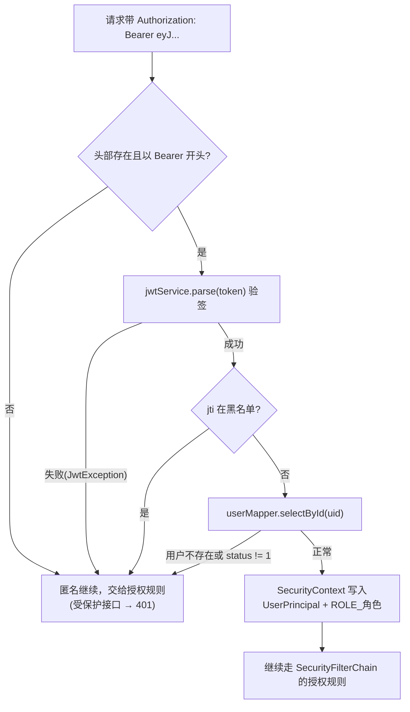
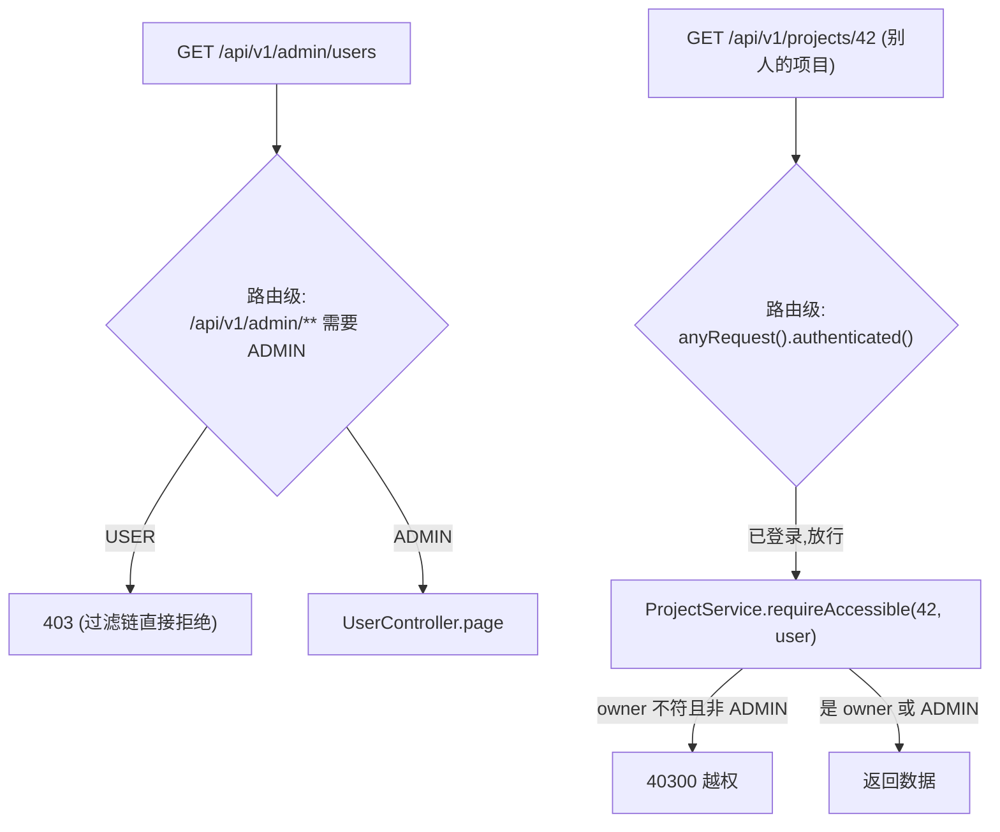

# 05 - 认证与权限详解

> 这一篇回答：一个请求带着 Token 进来，到拿到数据，中间的"你是谁"（认证）和"你能不能看"（授权）分别在哪一步、由谁判定。
> 涉及文件都在 `backend/src/main/java/com/devpilot/` 下：`security/`（JwtService、JwtAuthFilter、TokenBlacklist、SecurityUtils、UserPrincipal）、`common/config/`（SecurityConfig、TokenBlacklistConfig）、`module/auth/AuthService`、`module/project/ProjectService`。

## 1. 先搞懂两个词

- **认证（Authentication）**：证明"你是你"。本项目 = 校验 JWT。
- **授权（Authorization）**：判断"你能干什么"。本项目分两层：路由级（这个接口你要什么角色）+ 数据级（这条数据是不是你的）。

## 2. JWT 是什么、为什么用它

前后端分离 + 无状态服务的常见做法。JWT 本体是一段三节式的字符串（`xxx.yyy.zzz`：头部.载荷.签名）：

- 载荷里放用户信息（本项目放了 `uid`、`role`、`sub=username`、`jti=Token 唯一号`、`exp=过期时间`）；
- 服务器用密钥对"头部+载荷"做 HS256 签名。**客户端改一个字节，验签就失败**——这就是服务器敢信任载荷内容的原因。

对比 Session：Session 要在服务器存"登录状态"，JWT 不用存，验签通过即认账，天然适合水平扩展。代价是 JWT 签出来就收不回（Server 无处可删），于是需要第 5 节的"黑名单"补丁。

## 3. 签发：登录时发生什么

`module/auth/AuthService.login(LoginRequest)`，节选自真实代码：

```java
public LoginResponse login(LoginRequest request) {
    String username = request.username().trim();
    checkLocked(username);                                   // ① 登录失败限流（第 6 节）

    SysUser user = userService.getByUsername(username);
    if (user == null || !passwordEncoder.matches(request.password(), user.getPasswordHash())) {
        recordFailure(username);                             // ② 失败记账（注意：不提示"是哪个错"）
        throw new BizException(ErrorCode.BAD_REQUEST, "用户名或密码错误");
    }
    if (user.getStatus() == null || user.getStatus() != 1) {
        throw new BizException(ErrorCode.FORBIDDEN, "账号已被禁用，请联系管理员");
    }
    failedLogins.remove(username);                           // ③ 登录成功清空失败记录

    String token = jwtService.generate(user.getId(), user.getUsername(), user.getRole());
    return new LoginResponse(token, jwtService.getExpireMinutes() * 60, UserVO.from(user));
}
```

`JwtService.generate`（`security/JwtService.java`）用 jjwt 组装并签名：

```java
return Jwts.builder()
        .subject(username)
        .id(UUID.randomUUID().toString())        // jti：登出黑名单要用的 Token ID
        .claim("uid", userId)
        .claim("role", role)
        .expiration(Date.from(now.plus(expireMinutes, ChronoUnit.MINUTES)))  // 默认 120 分钟
        .signWith(key)                           // HS256
        .compact();
```

两个安全细节：

1. **密钥长度强制 ≥32 字节**：`JwtService` 构造器里显式检查，不够直接抛异常拒绝启动（HS256 对短密钥不够安全）。
2. **"用户名或密码错误"故意合并**：不告诉攻击者"用户名存在但密码错了"。

注册走 `AuthService.register` → `UserService.register`，密码用 `passwordEncoder.encode(password)`（BCrypt）后入库。

## 4. 校验：JwtAuthFilter 每次请求做什么

`security/JwtAuthFilter` 继承 `OncePerRequestFilter`，注册在 `SecurityConfig` 的过滤链里（`addFilterBefore(jwtAuthFilter, UsernamePasswordAuthenticationFilter.class)`），每个请求先经过它：



值得注意的设计决策（都写在类注释里）：

- **过滤器不做"拒绝"动作**：任何一步失败都让请求以匿名身份继续往下走，最终由 `SecurityConfig` 的授权规则统一给 401。好处：401 的格式（`{"code":40100,...}`）只有一个出口。
- **每次请求都查一次用户表**：`selectById(uid)` 后校验 `status == 1` 才写入认证信息。这样管理员禁用/删除用户后，该用户手里的旧 Token **立刻失效**，不用等 2 小时过期。代价是每请求多一次主键查询（演示规模完全可接受）。
- Controller/Service 里取当前用户用的是 `SecurityUtils.current()`：从 SecurityContext 拿 `UserPrincipal`（record：`id/username/role` + `isAdmin()`），拿不到抛 40100 异常。

## 5. 登出与黑名单：JWT 的"后悔药"

JWT 收不回，那就加一个"注销名单"。`POST /api/v1/auth/logout` → `AuthService.logout`：

```java
Claims claims = jwtService.parse(authorizationHeader.substring(7));
long remaining = claims.getExpiration().getTime() - System.currentTimeMillis();
tokenBlacklist.add(claims.getId(), remaining / 1000 + 1);   // jti 进黑名单，TTL = 剩余有效期
```

黑名单实现在 `common/config/TokenBlacklistConfig.java`，一个接口两种实现：

- **RedisTokenBlacklist**（首选）：`SET devpilot:token-bl:<jti> 1 EX <剩余秒数>`，TTL 到了自动清，集群部署也有效。
- **InMemoryTokenBlacklist**（降级）：`ConcurrentHashMap<String, 过期时间戳>`，查询时惰性清理过期项。

启动时怎么选？`tokenBlacklist(...)` Bean 方法先对 Redis 执行 `ping()`，返回 PONG 用 Redis；任何异常则 WARN 一行日志后用进程内实现。这就是"Redis 可选降级"——本地不装 Redis 也能完整跑通，只是重启后端后黑名单清空（演示无感；文档明确说明这只适用单实例）。

闭环验证在 `AuthPermissionIntegrationTest.logoutInvalidatesToken`：登出 → 用同一个 Token 再访问 `/users/me` → 断言 401。

## 6. 登录失败限流（进程内滑动窗口）

`AuthService` 顶部有一段很朴素的实现：

```java
/** username -> 最近失败时间戳队列（进程内限流，集群部署建议改用 Redis） */
private final Map<String, Deque<Long>> failedLogins = new ConcurrentHashMap<>();
```

- `checkLocked(username)`：统计该用户名在"锁定窗口"（`devpilot.login.lock-minutes`，默认 10 分钟）内的失败次数，达到 `max-fail-attempts`（默认 5 次）就抛 42900"登录失败次数过多，账号已锁定 10 分钟"。
- `recordFailure(username)`：失败时把当前时间戳塞进队列，队列超长（上限的 2 倍）就从头部裁剪。
- 登录成功 `failedLogins.remove(username)` 清零。

局限（代码注释自己承认的）：**只对单个后端进程有效**。两个后端实例各自记账，暴力破解阈值实际翻倍；集群要换 Redis。MVP 明说并接受。

## 7. 双层授权：路由级 + 数据级

只有认证没有授权，等于"登录后人人都是管理员"。DevPilot 的授权长这样：

### 7.1 第一层：路由级（SecurityConfig + @PreAuthorize）

`common/config/SecurityConfig.java`：

```java
.authorizeHttpRequests(auth -> auth
        .requestMatchers("/api/v1/auth/login", "/api/v1/auth/register").permitAll()
        .requestMatchers("/actuator/health", "/actuator/health/**", "/actuator/info").permitAll()
        .requestMatchers("/v3/api-docs/**", "/swagger-ui/**", "/swagger-ui.html").permitAll()
        .requestMatchers("/error").permitAll()
        .requestMatchers("/api/v1/admin/**").hasRole("ADMIN")      // ← 路由级：管理员专区
        .anyRequest().authenticated())                              // ← 其余：登录即可
```

需要更细粒度时用方法级注解，例如 `UserController` 的用户分页接口上有 `@PreAuthorize("hasRole('ADMIN')")`。403 的 JSON 由 `SecurityConfig` 的 `accessDeniedHandler` 统一输出。

### 7.2 第二层：数据级（Service 入口的归属校验）

路由级只回答"这个接口你能不能调"，回答不了"项目 42 是不是你的"。数据级校验收敛在一个方法——`module/project/ProjectService.requireAccessible`：

```java
/**
 * 归属校验：项目存在、未删除，且当前用户是 owner 或 ADMIN。
 * 越权访问统一返回 403。
 */
public Project requireAccessible(Long projectId, UserPrincipal user) {
    Project project = projectMapper.selectById(projectId);
    if (project == null) {
        throw BizException.notFound("项目不存在");
    }
    if (!user.isAdmin() && !project.getOwnerId().equals(user.id())) {
        throw BizException.forbidden("无权限访问该项目");
    }
    return project;
}
```

使用纪律（03 篇讲过依赖方向，这里是它的安全意义）：**所有项目域数据（repository、defect、ai_analysis、index_task）的 Service 方法，第一步都是先通过所属项目/资源的归属校验**。看真实调用链：

- `DefectService` 的每个公开方法第一行附近都有 `projectService.requireAccessible(defect.getProjectId(), user)`（私有 `requireAccessible` 包装）；
- `SearchService.search`：按 repositoryId 查时 `repositoryService.requireAccessible(...)`，按 projectId 查时 `projectService.requireAccessible(...)`；
- `IndexTaskService` 触发索引前 `repositoryService.requireAccessible(...)`。

另一侧是**列表查询按归属收窄**：`ProjectService.pageOf` 里 `.eq(!user.isAdmin(), Project::getOwnerId, user.id())` ——普通用户拼 SQL 时强制带 `owner_id = 本人`，管理员不带条件看全部。一句条件表达式同时实现"用户看自己的、管理员看全部"。

### 7.3 两层如何配合



记忆口诀：**路由级管"门"，数据级管"房间"**。门进了，房间还要一个个核对门牌。

## 8. 防越权是怎么被测试证明的

测试文件：`backend/src/test/java/com/devpilot/AuthPermissionIntegrationTest.java`（7 个用例，基类 `IntegrationTestBase` 提供注册/登录/建项目的辅助方法）。它走的是 MockMvc **全链路**——真实经过 JwtAuthFilter 和 SecurityFilterChain，AI 客户端打桩不依赖 Python。

| 用例 | 断言的核心 |
|---|---|
| `registerLoginMe` | 注册→登录→`/users/me` 返回同一用户名与 USER 角色 |
| `wrongPasswordRejected` | 错误口令 → 400 且 code=40001（不泄露是哪个错） |
| `forgedTokenUnauthorized` | 手工伪造 `Bearer not.a.jwt` → 401（验签不是摆设） |
| `userCannotAccessAdminApi` | USER 调 `/api/v1/admin/users` → 403（路由级） |
| `userCannotReadOthersProject` | **攻击者用户 B 用自己的合法 Token 读用户 A 的项目 → 403 且 code=40300**（数据级） |
| `adminCanAccessAnyProject` | ADMIN 能读任意项目；owner 能读自己的（规则的正向面） |
| `logoutInvalidatesToken` | 登出后同一 Token 立即 401（黑名单生效） |

其中 `userCannotReadOthersProject` 是防越权的代表性写法——**用"另一个真实登录的用户"发起攻击**，而不是只靠模拟匿名：

```java
String ownerToken = registerAndLogin(uniqueName("owner"));
long projectId = createProject(ownerToken, uniqueName("proj"));

String attackerToken = registerAndLogin(uniqueName("attacker"));   // 完全合法的第二个用户

mockMvc.perform(get("/api/v1/projects/" + projectId)
                .header("Authorization", "Bearer " + attackerToken))
        .andExpect(status().isForbidden())
        .andExpect(jsonPath("$.code").value(40300));
```

同样的模式也出现在端到端脚本 `scripts/e2e_flow.py`（第 16 项"越权访问他人项目被拒绝(403)"）里，作为黑盒视角的复验。这 7 个用例属于 `mvn test` 20 个全过用例的一部分（测试连本机 3307 的 `devpilot_test` 库，见 02 篇）。

## 9. 小结与自测

1. 为什么过滤器解析 Token 失败不直接回 401？（统一由授权规则的 entryPoint 出口，401 格式只有一份）
2. 禁用用户后他的旧 Token 为什么立刻失效？（JwtAuthFilter 每请求查用户表校验 status==1）
3. 登出后 Token 为什么不能"删除"，只能"拉黑"？TTL 为什么设成剩余有效期？（JWT 无状态收不回；TTL=剩余期则黑名单条目自然过期，不占存储也不会多拦）
4. `requireAccessible` 为什么放 Service 而不是 Controller？（所有模块共用同一道数据级闸门，Controller 只管参数；放 Controller 等于每个接口各自为战）
5. 如果把 `/api/v1/admin/**` 的 `hasRole("ADMIN")` 删掉，测试里哪个用例会红？（`userCannotAccessAdminApi`——`@PreAuthorize` 与路由级规则互为冗余防护，这是有意的纵深）
